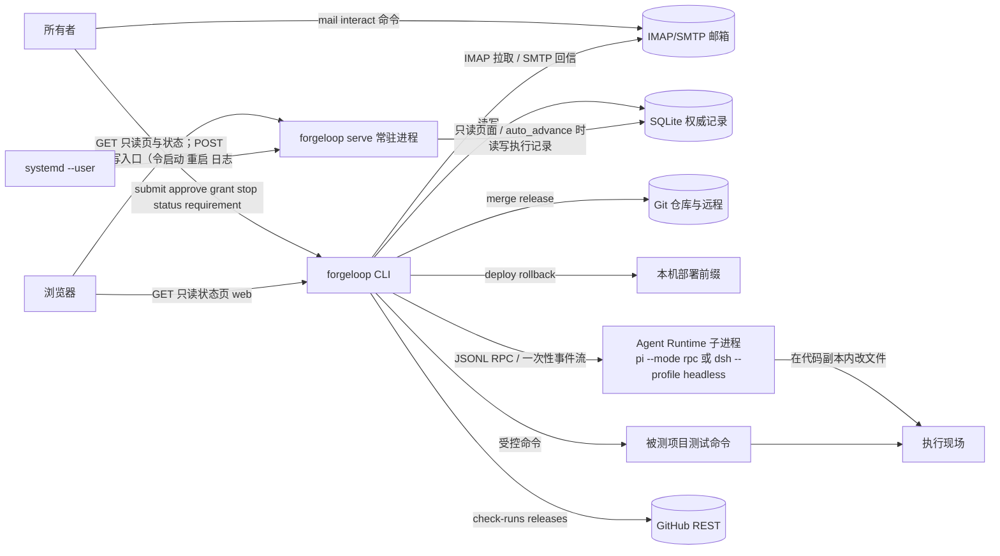
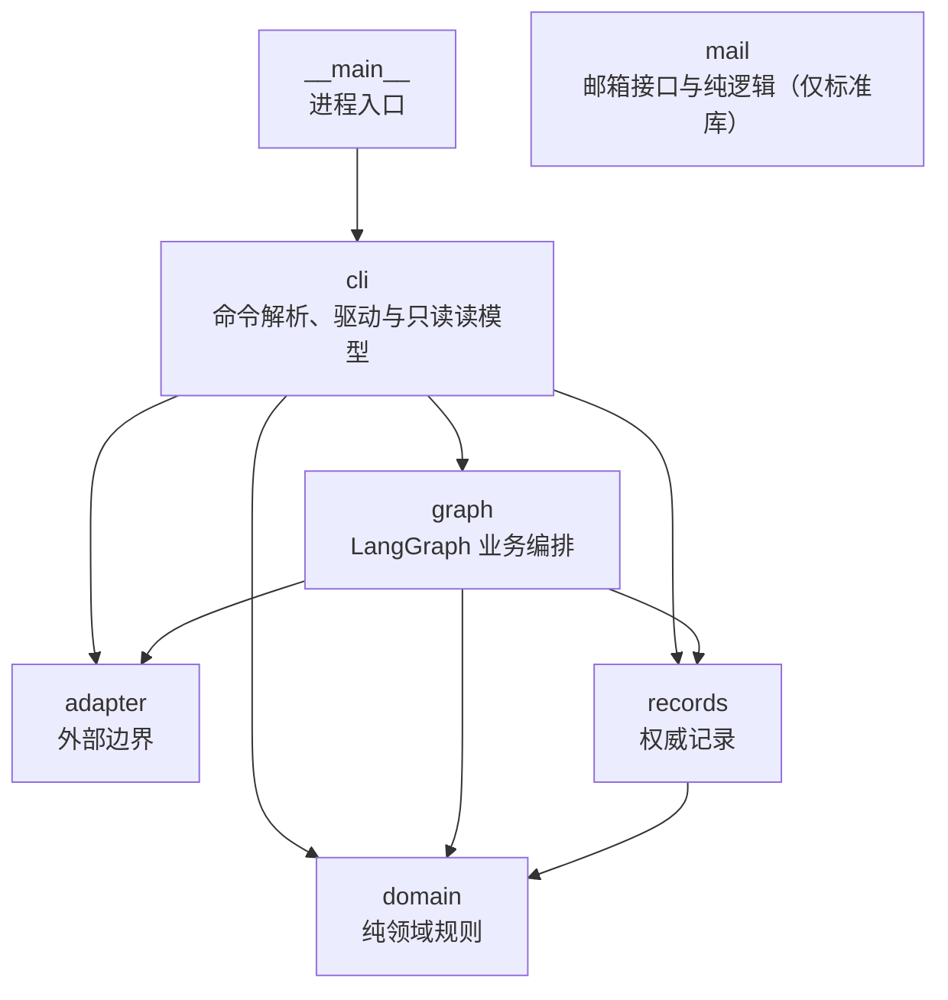
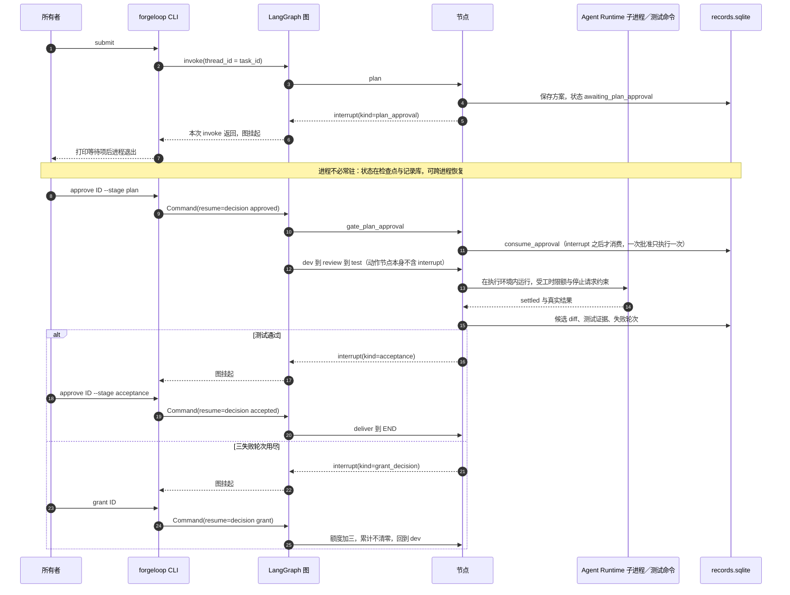
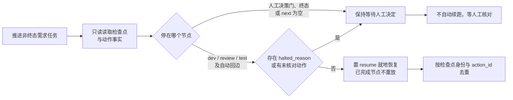
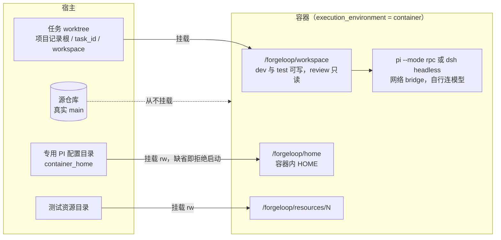
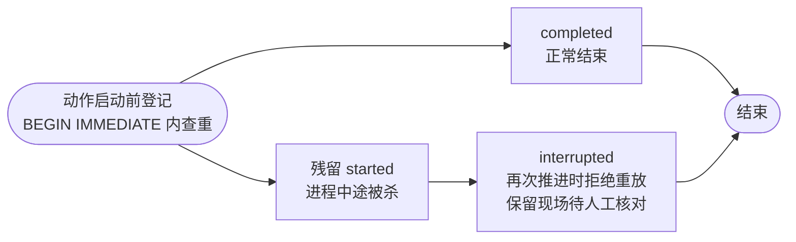
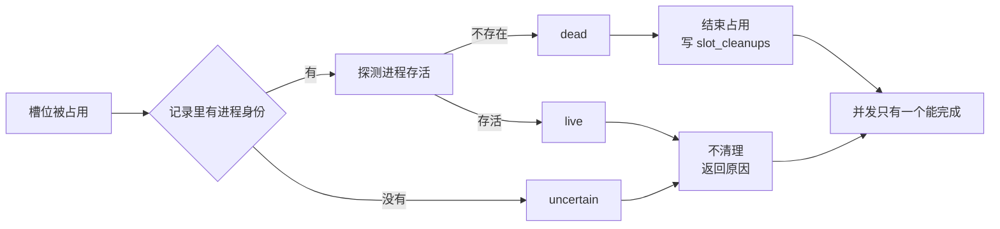
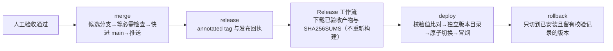

# ForgeLoop 架构说明

本文描述 **`src/forgeloop` 已实现的实际架构**：分层、模块职责、依赖方向、业务图、持久化与外部边界。它不描述尚未实现的设计意图，也不记录当前验证数字。

| 想知道 | 看哪里 |
| --- | --- |
| 架构长什么样（已实现） | 本文，以及机读快照 `contracts/architecture.json` |
| 为什么这样选（方向性决策） | `docs/adr/` |
| 首版做哪些需求 | `docs/product-requirements.md` |
| 现在跑到哪一步、验证数字 | `docs/status.md` |
| 工程门槛与统计口径 | `docs/engineering-reliability.md` |
| 领域词义 | `CONTEXT.md` |

**维护义务（强制）**：架构变化必须与本文、`contracts/architecture.json` 在同一次改动中同步更新。该义务由 `scripts/export_architecture_contract.py --check`（`make check` 的一环）机器强制；判定标准与流程见第 9 节。

## 1. 系统上下文

ForgeLoop 是单用户、多项目隔离的本地 CLI 工具：每个已登记项目拥有独立的代码仓镜像与记录根，项目之间不共享需求、任务、检查点、会话、worktree 或提交；单个项目内一次推进一个任务，需求内的任务按依赖串行执行。操作者是任务所有者，负责项目登记、方案／任务包与验收批准、追加授权，以及需求整体验收决定。

外部系统共九类，都是真实外部边界，不是可忽略的实现细节：Agent Runtime 子进程（PI RPC 或 DSH headless，见 §7）、git CLI 与真实仓库（项目源仓库、项目 bare 镜像与任务 worktree）、GitHub REST（公开数据可匿名读；检查读取用 `GITHUB_TOKEN`／`GH_TOKEN` 提高配额，未提供即匿名）、本机部署前缀（符号链接＋独立 venv）、被测项目的测试命令进程、真实 IMAP/SMTP 邮箱服务（`mail poll`／`mail confirm` 分类工作流与 `mail interact` 交互入口共用；发件来源、命令幂等与不确定现场由应用层校验）、本机回环 HTTP 套接字与浏览器请求（`web` 只读状态页；`serve` 的只读页面、`GET /api/service`、页面写入口与会话面板）、系统时钟、systemd user 服务管理器与 journal 日志（`serve` 的常驻载体，模板见 `runtime/systemd/forgeloop-serve.service`）。

## 2. 分层与依赖方向

包按职责分六层，外加进程入口。层是**物理目录**，不是抽象概念：模块名形如 `forgeloop.<层>.*`。

允许的依赖方向（`scripts/export_architecture_contract.py` 的 `LAYER_RULES`；机读事实见 `contracts/architecture.json` 的 `layer_edges`）：

| 层 | 允许依赖 | 实际跨层边 |
| --- | --- | --- |
| `(root)`（顶层包） | 无 | 无 |
| `__main__` | `cli` | → `cli` |
| `cli` | `graph`、`adapter`、`records`、`domain` | → `graph`、`adapter`、`records`、`domain` |
| `graph` | `adapter`、`records`、`domain` | → `adapter`、`records`、`domain` |
| `adapter` | 无 | 无 |
| `records` | `domain` | → `domain` |
| `domain` | 无 | 无 |
| `mail` | 无（只依赖标准库） | 无（模块间仅同层依赖） |

三条硬规则，由门槛强制：

1. **`domain` 是纯规则层。** 零跨层依赖、零第三方依赖（全部 import 均为标准库），也不依赖 `langgraph`；同层内部有 9 条边、构成深度为 1 的 DAG：`approval`→`delivery`、`artifact`→`release`、`budget_summary`→`limits`、`deploy`→`release`、`merge`→`delivery`、`progress`→`requirement`、`repo_facts`→`task_plan`、`status_reason`→`counting` 与 `status_reason`→`dependency_facts`。唯一在导入期读文件系统的是 `repo_facts`（解析机读架构契约，缺失时对路径校验 fail-closed），不违反分层方向。
2. **`adapter` 与 `mail` 是叶子层（无跨层依赖）。** 二者都只用标准库，适配器不知道领域规则与记录结构，邮箱层只提供接口与纯逻辑。`adapter` 内部有三条同层依赖：`artifact` → `deployment`（复用 wheel 安装与校验值工具）、`pi_rpc` → `agent_runtime` 与 `dsh_headless` → `agent_runtime`（两个执行器实现共同契约类型，方向单向无环），不属于跨层违规。
3. **模块依赖图无环。** 跨层与同层边一起检查。`graph.requirements` 刻意不 import `graph.builder`（改用注入）以避开层内环。

`pyproject.toml` 的 `[tool.importlinter]` 另有两条同型的 `forbidden` 契约：禁止 `forgeloop.domain` 依赖 `cli`／`graph`／`adapter`／`langgraph`，禁止 `forgeloop.mail` 依赖 `cli`／`graph`／`records`／`adapter`／`langgraph`。本文的 `LAYER_RULES` 是覆盖全部层的更完整版本。

## 3. 模块清单

| 层 | 文件 | 职责 |
| --- | --- | --- |
| 顶层 | `src/forgeloop/__init__.py` | 包声明，无逻辑 |
| 入口 | `src/forgeloop/__main__.py` | `python -m forgeloop` 入口，转调 `cli.main` |
| domain | `src/forgeloop/domain/__init__.py` | 层声明与分层契约指向 |
| domain | `src/forgeloop/domain/agent_runtime.py` | Agent Runtime 纯规则：运行时名字（`pi`／`dsh`）、启动命令解析与选择优先级（环境覆盖 > 运行状态 > 任务配置 > 内建默认）；缺命令或未知运行时 fail-closed，热切换的判定口径只此一份 |
| domain | `src/forgeloop/domain/counting.py` | 失败轮次账本 `GrantLedger`：按 `round_id` 幂等计数、每次授权 3 轮、追加授权累加不清零 |
| domain | `src/forgeloop/domain/status.py` | 任务状态 → 下一步动作的纯映射：动作、主体（user／agent）与阻塞／等待原因；未知状态落到人工核对 |
| domain | `src/forgeloop/domain/dependency_facts.py` | 依赖事实与真实阻塞判定的纯规则：前置未达 accepted／delivered 等终态即未满足；有未满足前置且无 `started` 未完成动作才判 `waiting`；状态词滞后不判阻塞；依据缺失输出 `unknown` 并列出缺少的记录 |
| domain | `src/forgeloop/domain/status_reason.py` | 中文阻断原因 `blocked_reason_text` 的纯推导：只读权威事实（任务／方案／批准／动作／失败轮次／授权／工时／终态），主句按固定优先级（等待人工决定 → 依赖未满足 → 失败轮次用尽 → 运行中 → 已终态）选取，句末「；另外还有…」最多补两条其他成立条件；依据缺失输出 `unknown` 并列出缺少的记录 |
| domain | `src/forgeloop/domain/progress.py` | 状态页纯规则：刷新间隔来源优先级（CLI 参数 → 配置文件 → 内建默认 60 秒）、`0` 关闭自动刷新与非法值明确拒绝；「问题」分类只取需要人工介入的状态（阻断／中断／等待追加授权／工时耗尽／待确认停止）与未完成执行槽位，正常流程门（等待批准、等待验收、等待澄清）不算问题，未知状态不猜测 |
| domain | `src/forgeloop/domain/project.py` | 项目身份与记录根纯规则：项目身份是 2–63 位小写字母／数字／连字符的稳定标识（直接成为目录名，拒绝路径穿越形状）；显示名、仓库路径与默认分支的形状校验；项目记录根固定为 `<records_root>/projects/<project_id>` |
| domain | `src/forgeloop/domain/requirement.py` | 需求身份与版本规则：`req-<YYYYmmddHHMMSS>-<6 位随机>` 全局唯一、原文占版本 1 永久保留、追加版本只增不覆盖、未知身份明确失败；只读分析的结构化校验（A02）也落在本模块 |
| domain | `src/forgeloop/domain/task_plan.py` | 任务包规则：从分析产出至少两个有依赖的任务；未批准不执行；旧版本或过期批准不能驱动最新任务包 |
| domain | `src/forgeloop/domain/repo_facts.py` | 仓库布局事实与任务包合规校验：源码根与合法源码分层从机读架构契约 `contracts/architecture.json` 的 `modules`／`layer_edges` 动态解析，契约缺失或损坏时导入不崩溃并对路径 fail-closed；测试分层、契约快照、可用解释器与门禁命令仍为固定事实；纯规则校验文件清单与测试命令，逐条给出具体路径／命令与原因 |
| domain | `src/forgeloop/domain/artifact.py` | 候选产物身份与校验规则：wheel 文件名 + SHA256、同一候选重复构建的一致性判定、未授权提交拒绝 |
| domain | `src/forgeloop/domain/limits.py` | 执行时间账目 `ExecutionBudget`：只记实际执行耗时、超限停止启动新动作、显式延长 |
| domain | `src/forgeloop/domain/budget_summary.py` | 工时摘要 `BudgetSummary` 的只读纯规则：无 budget 行且状态未开始记为 `not_started` 且不产生 0 秒歧义；有 budget 行输出 `consumed_seconds`／`limit_seconds`／`exhausted`；存在性与状态冲突以存在 budget 行为准输出 `unknown` 并说明冲突；`dimensions` 当前仅 `seconds` |
| domain | `src/forgeloop/domain/approval.py` | 方案 `Plan` 与批准 `Approval`：批准绑定任务身份与方案版本，一次批准只能触发一次执行；验收批准还绑定实际交付材料（候选 diff、测试证据、审查结论、产物校验值），替换材料后原批准失效 |
| domain | `src/forgeloop/domain/delivery.py` | 交付绑定 `DeliveryBinding` 与需求整体验收判定：候选 diff／测试证据／审查结论／产物校验值各自内容寻址；材料变化使批准失效；单个任务通过不等于需求整体验收 |
| domain | `src/forgeloop/domain/commit_policy.py` | 提交时间策略与年度工作日历判定、Conventional Commits 首行校验；把唯一一份本机配置构造为生效策略、授权硬上限（终点 ≤ 10:00）与机器标签；没有配置时的判定显式记为 `policy_absent`，不假装规则生效 |
| domain | `src/forgeloop/domain/merge.py` | 归并就绪判定与必需检查判定（候选分支 → 检查 → 快进 main）；2026-10-18 所有者决定后判据为「验收材料未变 + 候选可干净应用」，**不再要求** `main HEAD == 交付基线`（任务与 commit 是累积关联） |
| domain | `src/forgeloop/domain/release.py` | 发布就绪判定、版本标签解析、发布记录 `ReleaseRecord`、同标签幂等／换标签拒绝 |
| domain | `src/forgeloop/domain/deploy.py` | 部署与回滚就绪判定、`SHA256SUMS` 解析、产物唯一选择（拒绝重新构建） |
| domain | `src/forgeloop/domain/service.py` | 常驻服务配置纯规则：只允许回环监听地址、端口／轮询间隔／并发上限的整数与范围判定、自动推进开关必须为布尔、项目档案（项目路径、PI 命令、测试命令、隔离 HOME）字段校验；未知键与非法值一律显式失败，不静默回落 |；**面板会话设置**（并发上限、单轮超时、常驻会话上限与空闲回收秒数、工具审批策略 off/write/all）也在本模块校验
| domain | `src/forgeloop/domain/mail.py` | 邮件需求领域规则：三类分类建议（消歧／不接纳候选／接纳成功）、消歧轮次上限 3 轮后退回人工、终态不再提问、7 天无回复单次提醒与开关、回复关联按 `In-Reply-To`／`References`／主题／正文回退解析（`req-…` 与 `#req-…` 都接受）、中文纯文本固定模板渲染；附件只记录元数据 |
| domain | `src/forgeloop/domain/mail_interaction.py` | 邮箱交互协议纯规则：固定命令词与中文别名的确定性解析（带其他文字的「状态：…」不算命令）、引用与签名剔除后的修订正文提取（识别 `>`、签名分隔、「原始邮件」与 `On … wrote:` 等引用分隔）、发件地址归一与白名单失败关闭、`Auto-Submitted` 自动回复判定、稳定回信主题与命令帮助文本；不做自然语言推断，不把「同意」当作批准 |
| records | `src/forgeloop/records/__init__.py` | 层声明，并只再导出 `checkpoints` 的人工续跑 API；不导出各 Store。注意：它顶层导入 `checkpoints`（后者依赖 `langgraph`），因此导入任一 `forgeloop.records.*` 都会**传递依赖 `langgraph`** |
| records | `src/forgeloop/records/agent_runtimes.py` | `AgentRuntimeStore`：Agent Runtime 运行状态（当前选择、命令、更新时间/人/理由）与切换审计（`agent_runtime_state`／`agent_runtime_switches` 两张表，同 `records.sqlite`）；`by`／`reason` 空白或运行时非法 fail-closed 且零副作用 |
| records | `src/forgeloop/records/store.py` | `RecordStore`／`OutcomeStore`：SQLite 15 张任务侧表的权威业务记录（另有 `records.checkpoints` 管理的 `action_releases` 释放审计表，共 16 张），读时重建领域对象；`read_task_dependency_record` 只读汇总单任务终态、`started` 动作与失败轮次事实；`all_tasks` 跨项目只读列出全部任务（状态页清单）；`prerequisite_applications` 固化下游任务各前置候选的应用状态与原因（幂等判定与回退依据）；旧库缺少动作进程列时显式补列；`task_commits` 记录任务与 commit 的**一对多累积关联**（`implementation`／`acceptance`／`merge` 三类，只追加不覆盖，重复调用幂等） |
| domain | `src/forgeloop/domain/toml_fields.py` | TOML 配置字段的公共校验原语（字符串／可选字符串／整数／数字／布尔／argv 数组／项目名与未知键拒绝）：常驻服务配置与面板项目档案共用同一份口径，各自传入自己的异常类型，错误消息因此能指明是哪份配置，规则不会两边漂移；本模块不读文件、不认识路径 |
| domain | `src/forgeloop/domain/conversation.py` | 面板会话纯规则：会话状态（进行中／等待人工决定／已终止，**没有单独的失败态**——一轮失败停在等待人工决定）、消息与标题校验、单轮提示词组装（项目身份 + 显式 HITL 契约 + 最近历史回放 + 本次人工输入，超长按上限截断并标注）与 Agent 输出的解释（只有解析出 `{"awaiting_human": true, "question": …}` 才算请求人工决定，不用自然语言猜测） |
| domain | `src/forgeloop/domain/projects.py` | 面板项目档案纯规则：字段校验（路径／描述／PI argv／隔离 HOME）、两个来源（手写 `config/service.toml` 与页面档案）的合并与同名冲突拒绝、整份档案的确定性 TOML 序列化（键排序、统一转义，便于人工复核 diff）；本模块不碰文件系统 |
| records | `src/forgeloop/records/conversations.py` | 面板会话记录 `ConversationStore`：`panel_sessions`（会话身份、项目、状态、轮次计数、终止事实与自动压缩计数 `compaction_count`）、`panel_messages`（人工／Agent／系统消息；含 `state` 的 `streaming` 中间态与人工消息的 `context_mode`：`cold` 回放历史／`warm` 续接常驻进程）、`panel_decisions`（待人工决定：Agent 主动请求、一轮失败、或轮次边界的工具审批 `tool_review`）、`panel_tool_calls`（逐次工具调用事实：名字、参数与结果摘要、风险级别、状态、耗时、是否需要审批与审批状态；主键是 `(session_id, tool_call_id)`——PI 的 `toolCallId` 只在会话内唯一，用全局主键会让两个会话的同名调用互相覆盖）四张表；流式消息先建行再反复更新（不是每个增量一行），轮末落定；终态一旦落下不得被后续轮次改回进行中，终止与决定都幂等（同结论返回既有事实、不同结论显式失败） |
| records | `src/forgeloop/records/actions.py` | `ActionStore`：动作启动/完成身份、进程身份与心跳，以及单任务并发占用；未完成动作拒绝重放；按权威记录判定槽位残留（空闲／已死／存活／不确定），只清理已死残留并写入 `slot_cleanups`，不确定时不清理并给出原因 |
| records | `src/forgeloop/records/checkpoints.py` | 读取记录根下 `checkpoints.sqlite` 的 LangGraph 检查点：给出待执行节点、`halted_reason` 与检查点身份，判定可续跑业务节点（`dev`/`review`/`test` 及自动回边）与等待人工决定（计划批准、追加授权、整体验收、终态、空 `next`）；以 `actions.action_id` 去重判断重复推进，记录缺失输出 `unknown`。人工续跑规则也在此（缺陷 #24 修复后）：检查点自身无法归因的陈旧中断（如迁移前的 `plan_approval_stale`）必须由人工用 `--node dev|review|test` 显式点名重入节点才放行，可归因的中断不得改指其他节点，未点名一律 fail-closed；点名的节点随决定一起落库（`resume_node` 列，旧库读取时按缺列处理），清除 `halted_reason` 时据此补齐重入点。人工释放未完成动作的规则也在此：只有动作身份能在权威记录中定位、属于目标任务、仍是 `started` 且调用方标识与理由非空时，才在同一事务内把动作置为 `released` 并写入 `action_releases` 审计（谁/何时/理由/动作身份/所属任务与节点）；缺理由、身份不明或任务不匹配一律 fail-closed 拒绝；另在 `records.sqlite` 维护人工续跑决定表 `requirement_retry_decisions`，并做 fail-closed 前置校验（任务状态、检查点缺失／读取失败／损坏、`task_id`／`plan_version` 不符、`interrupted` 无 `halted_reason` 一律拒绝），仅当决定与当前检查点身份／方案版本匹配时才把 `halted_reason` 视为已清除 |
| records | `src/forgeloop/records/requirements.py` | 需求记录：需求、版本、分析、任务包、批准、任务推进、产物与需求工时共 8 张表；与任务记录同一 `records.sqlite`，提交原文、追加版本、按身份与项目回查（进程重启后仍可读）；`all_requirements` 跨项目只读列出全部需求（状态页清单）；`dependency_facts` 按任务包依赖只读汇总每个任务的依赖事实 |
| records | `src/forgeloop/records/projects.py` | 项目登记与定位：`projects.sqlite` 保存项目身份、显示名、仓库路径、默认分支与迁移前旧名；项目记录根固定为 `<records_root>/projects/<id>`；跨项目唯一定位任务／需求（零命中与重复都失败）、跨项目查找发布回执、汇总项目计数；`migrate_legacy` 把旧根目录记录整体迁入项目，混合项目身份时拒绝 |
| records | `src/forgeloop/records/mail_threads.py` | 邮件线索记录 `MailThreadStore`：每封出向反馈把自己的 Message-ID 与 `req_id`／`kind`／`sent_at` 绑定进 `mail_threads`，同一需求多轮消歧只追加不覆盖；与 `mail_deliveries`（出向幂等）和 `mail_inbound`（入向去重）同库协同，按时间合并还原完整收发往来 |
| records | `src/forgeloop/records/mail_interactions.py` | 邮箱交互账 `MailInteractionStore`：`mail_interactions` 以入向 Message-ID 为主键先占位再执行，重复轮询不重复建档／批准／推进；命令结果先落回信内容与自身 Message-ID（`action_done`）再发送，发送失败只重发；进程中断的 `executing` 现场标记 `uncertain` 供人工核对，不自动重放；出向回信 Message-ID 可反查需求，供 `In-Reply-To`／`References` 还原线程 |
| adapter | `src/forgeloop/adapter/__init__.py` | 层声明 |
| adapter | `src/forgeloop/adapter/commit_policy.py` | 本机提交策略配置的 IO 边界：按固定优先级二选一发现并读取生效配置 TOML（仓库内 `.cache/forgeloop/commit-policy.toml`，其次用户级 `~/.config/forgeloop/commit-policy.toml`）与年历；两处都没有时返回空文档（不强制），旧路径 `commit-policy.local.toml` 存在即报错要求迁移；只返回原始文档，不做策略判定 |
| adapter | `src/forgeloop/adapter/agent_runtime.py` | Agent Runtime 通用契约：事件、调用结果（`settled`／`aborted`／`model_error`／`error` 与运行时身份）、启动选项、会话文件命名与共用的 JSONL 行读取器；不 import 任何具体实现（PI/DSH 反向依赖它） |
| adapter | `src/forgeloop/adapter/pi_rpc.py` | `PIProcess`：PI 的 JSONL RPC 子进程、命令／响应 id 关联、`agent_settled` 判定、abort、会话与 stderr 落盘（类型来自 `agent_runtime`） |
| adapter | `src/forgeloop/adapter/dsh_headless.py` | `DSHProcess`：DSH headless 一次性子进程（提示词进 stdin、stdout 为 `--json` 事件流）；按 `final`／`error` 事件与 `turn_end.reason.kind` 归类，只有 `completed` 与 `aborted` 记为 settled，其余终态按未取得结果上报 |
| adapter | `src/forgeloop/adapter/test_runner.py` | `run_test_command`：以 argv＋`shell=False` 运行批准的测试命令，证据追加 JSONL |
| adapter | `src/forgeloop/adapter/git_workspace.py` | 独立代码副本、基线 detached 检出、候选 diff 提取、受控归并与标签 |
| adapter | `src/forgeloop/adapter/github_checks.py` | 读取提交的 check-runs（有 `GITHUB_TOKEN`／`GH_TOKEN` 则按认证配额，否则匿名），归一为「名称 → 结论」或 `pending`；403/429 归一为带剩余量与重置时刻的配额耗尽错误 |
| adapter | `src/forgeloop/adapter/deployment.py` | 下载 Release 资产、独立版本 venv 安装、原子切换 `current`、冒烟检查、部署日志 |
| adapter | `src/forgeloop/adapter/execution_environment.py` | 受限执行环境（两种模式，dev／review／test 共用）：`container` 用容器运行时（默认 `docker`）执行，只挂载工作副本（dev／test 可写、review 只读）、专用 PI 配置目录与测试资源，源仓库从不挂载、容器内没有源库／main 写入口（镜像见 `runtime/Dockerfile`）；`host` 直跑，只支撑「本次运行未改写源库」。模式由任务配置或 `FORGELOOP_EXECUTION_ENV` 等环境变量选择，**默认 `host`**，无 CLI 参数 |
| adapter | `src/forgeloop/adapter/artifact.py` | 候选产物构建与验证：真实 `uv build`（工作区内缓存）、独立 venv 安装、`forgeloop --help` 冒烟 |
| adapter | `src/forgeloop/adapter/mail.py` | `ImapMailReceiver`／`SmtpMailSender`：邮箱授权码登录 IMAP/SMTP，`poll_once` 单次拉取未读邮件并解析为 `InboundMail`（缺 Message-ID 判为无法解析；RFC 2047 编码的 `From`／`Subject` 解码后再关联；保留 `Auto-Submitted` 供交互入口拒绝自动回复），出向先写自身 Message-ID 再发送、成功才交记录接缝落库；`send_reply` 只发交互回信（保留 `In-Reply-To`／`References`），发送失败抛 `MailSendError` 不静默丢弃，附件只留元数据不解析；入向拉取自 2026-10-18 起默认拉取文件夹内**全部**邮件（共享邮箱里客户端会把邮件读掉，`UNSEEN` 会漏处理），由 `Message-ID` 幂等去重，需要旧行为时置 `only_unseen=True` |
| graph | `src/forgeloop/graph/__init__.py` | 层声明 |
| graph | `src/forgeloop/graph/state.py` | `TaskState`：只放路由与续跑所需的最小字段 |
| graph | `src/forgeloop/graph/planning.py` | 需求只读分析：Agent Runtime（PI 或 DSH）产出目标／场景／验收标准／待澄清项并做结构化校验；缺信息等待澄清、畸形如实阻塞，只追加版本不改源码；分析与规划也按热切换规则解析运行时 |
| graph | `src/forgeloop/graph/dispatch.py` | 多需求并行推进：每需求独立记录与现场、重复启动被拒；同项目交付（归并／发布）程序互斥串行，不依赖人工安排 |
| graph | `src/forgeloop/graph/session_runtime.py` | 会话常驻进程池 `SessionProcessPool`（服务端多轮上下文）：一个会话一个 PI 进程，暖进程直接承接下一轮（上下文在它手里，提示词只带本次输入），进程退出或被回收后由下一次取用换新并回放历史；空闲超过 `session_idle_seconds` 回收，空闲槽位按最近使用淘汰（`max_live_sessions`），正在跑的一轮既不回收也不被淘汰；`status()` 给出每个常驻会话的 pid、轮次数、冷启动次数与空闲秒数，停机时中止并关闭全部进程。**真实模型下「同一进程第二轮确实看得见第一轮上下文」未经实测**（本环境无 `pi` 二进制），调度与状态机由假 PI 覆盖 |
| graph | `src/forgeloop/graph/conversation.py` | 面板会话的一轮执行 `ConversationRunner`：受理一条人工消息（线程池、并发上限、消息先落库、HTTP 立即返回 202），启动 PI RPC 子进程（工作目录固定为项目路径、`HOME` 显式为该项目的隔离目录）、发送提示词（冷启动回放历史、暖进程只发本次输入）、等 `agent_settled` 后把结果落成消息与「待人工决定」；整轮结束前按 `message_update` 的文本增量**流式落库**（节流写入同一条 `streaming` 消息，轮末落定）；逐次记录 `tool_execution_start/end`（名字、参数与结果摘要、风险级别、耗时、是否报错）并在**轮次边界**对需确认的工具开人工审批闸门（协议没有执行前拦截事件，文案如实写明工具已经跑过）；PI 的自动压缩（`entry_appended` 的 `context_edit`）记一条系统消息并累加计数，本会话流水只追加不删除；终止会先写终态再发 `abort`，因此收尾的那一轮无法把会话改回进行中；超时／协议错误／无文本／模型错误一律按失败停在人工决定前，不自动重试 |
| graph | `src/forgeloop/graph/worker.py` | 常驻 worker（R2）：一个 daemon 线程按 `poll_seconds` 心跳；`survey()` **只读**筛选可自动接续的需求（项目已配置、任务包已批准、下一步主体是 agent、PI HOME 与进程 HOME 一致），不放行时逐条给出原因；`auto_advance` 打开时把筛选结果交给既有 `RequirementDispatcher`／`RequirementExecutor` 执行（并发上限、同需求互斥、同项目交付串行、停止与失败累计全部复用），关闭时只报告；单次心跳异常记入 `last_error` 并继续下一拍；**R4 起进程启动时（以及每次构建状态文档时）做一次只读启动核对** `reconcile()`：把未核对动作与残留槽位连同副作用证据（候选 diff 的 sha256、工作副本是否存在）列成「需人工核对」清单，存在未释放动作的任务**一律不自动推进**（与执行器内的 B03 判定同一口径的第二道闸门），恢复仍走 `requirement actions clear`／`slot clear`／`retry` |
| graph | `src/forgeloop/graph/requirements.py` | 需求执行编排（A04）：按依赖串行推进已批准任务包；把已确认前置产物交给下游；等待不计执行工时；汇总当前任务、阻塞原因与下一步动作 |
| graph | `src/forgeloop/graph/agent_execution.py` | Agent Runtime 执行接缝：**每次动作启动前**读取运行状态与进程环境覆盖解析运行时，按名字构造 PI/DSH 会话并跑完一次调用；热切换与缺命令 fail-closed 的唯一入口 |
| graph | `src/forgeloop/graph/nodes.py` | 八个节点工厂与 `NodeContext`：方案、批准门、实现、审查、测试、追加授权门、验收门、交付；实现与审查会话经 `agent_execution` 解析运行时并把运行时身份写入报告 |
| graph | `src/forgeloop/graph/evidence.py` | 失败回边证据读取：上一轮正式测试输出尾部与审查阻断问题（截断，供实现会话修复） |
| graph | `src/forgeloop/graph/prompts.py` | 提示词构造（纯函数）：开发提示（目标/范围/验收/工作区/尝试序号/批准测试命令/自验证要求/失败回边）与审查提示（含输出契约常量） |
| graph | `src/forgeloop/graph/builder.py` | 图装配：节点注册、条件路由、SQLite 持久 checkpointer；`RequirementTaskRunner` 把已批准需求任务映射到单任务图 |
| cli | `src/forgeloop/cli/__init__.py` | 惰性导出 `main`（首次读取属性才加载实现，轻量提交策略入口不拉入编排依赖栈） |
| cli | `src/forgeloop/cli/common.py` | 三个共享助手：`records_root(args)` 解析记录根、`open_store(root, task_id)` 打开记录库并在任务不存在时以 `SystemExit` 确定失败、`fail(msg)` 输出 `FAIL:` 到 stderr 并返回 1。注意：`fail` 只被 candidate／deploy／mail／release／web 使用，`main`／`requirements` 走自己的 `SystemExit` 或 `print + return 1`，失败输出并非全命令统一 |
| cli | `src/forgeloop/cli/main.py` | 单任务命令 `submit`／`approve`／`grant`／`status`／`stop`，需求线主体命令（含中断核对入口 `requirement actions list|clear` 与 `requirement slot list|clear`），参数总装（`build_parser()`），以及只读查询文档构建器 `_status_document`／`_requirement_document`（被 `cli.web` 以 `ProgressDocuments` 注入复用、被契约快照脚本复用） |
| cli | `src/forgeloop/cli/commit_policy.py` | 提交策略命令：加载本机生效配置（可能缺失），放行/拒绝审计输出生效配置路径与来源、机器标签与命中时间窗；无配置时放行并标注 `policy_absent`／NOT enforced；文案明确为客户端限制而非服务端强制 |
| cli | `src/forgeloop/cli/merge.py` | `merge`：候选分支流程与归并证据 |
| cli | `src/forgeloop/cli/candidate.py` | `candidate <task_id>`：从已归并的授权提交真实构建候选产物、记录身份与 SHA256、重复构建校验可复现并在独立环境冒烟（构建与验证在一次调用内完成） |
| cli | `src/forgeloop/cli/runtime.py` | `runtime show`／`set`／`list`：查看当前运行时与生效解析、热切换（`--by`／`--reason` 必填）并保留切换审计；`--json` 文档进入 `contracts/cli-contract.json` |
| cli | `src/forgeloop/cli/requirements.py` | `requirement` 命令组：受理／澄清／分析／规划／批准／推进／整体验收／人工续跑／状态回查，接线到真实业务记录 |
| cli | `src/forgeloop/cli/projects.py` | `project` 命令组：`add` 校验仓库并建立项目记录根与 bare 镜像，`list`／`show` 输出稳定 JSON 项目清单与计数，`update` 修改显示信息，`migrate` 把旧根目录记录一次性迁入已登记项目 |
| cli | `src/forgeloop/cli/release.py` | `release`：annotated tag、上传已验收产物为 Release 资产与发布回执 |
| cli | `src/forgeloop/cli/deploy.py` | `deploy`／`rollback`：从 Release 装产物、原子切换、回滚 |
| cli | `src/forgeloop/cli/mail.py` | `mail` 命令组（分类工作流）：`mail poll --once` 交接 cron 单次轮询、按领域规则给出三类分类建议并等待人工确认（绝不自动发信）；`mail confirm` 为人工确认后的唯一发信入口，不接纳最终决定需显式 `--final-not-accept`；三类反馈用稳定主题标记与固定中文纯文本正文，配对 `MailAdapter`／`MailThreadStore`／`RequirementStore`。同组的 `interact` 由 `cli.mail_interaction` 注册 |
| cli | `src/forgeloop/cli/mail_interaction.py` | 邮箱交互入口 `mail interact --once`：白名单与自动回复过滤、命令解析与占位幂等、回信先落库再发送、不确定现场提示；把 `status`／`revise`／`approve <版本>`／`accept`／`analyze`／`plan`／`advance`／`help` 接到既有 `RequirementStore`、`graph.planning`、`RequirementExecutor` 与 `RecordStore`，批准绑定最新任务包版本，长任务在轮询内同步执行（未配置 `--pi-command` 时只回复配置缺失） |
| cli | `src/forgeloop/cli/web.py` | `web` 命令：只读状态页（B01）。真实回环 HTTP 服务只接受 `GET`／`HEAD`，其余方法一律 405 且不写记录；`GET /api/progress` 复用 `cli.main` 的 `status`／`requirement status` 文档构建器组装需求、任务与问题三段，`GET /` 返回随包分发的页面结构 `web_page.html`，`GET /<name>.js` 按严格文件名白名单（不含路径分隔符）返回同一包内 `static/` 下的页面模块；监听地址默认回环，刷新间隔来自 `domain.progress` 的纯规则，配置项见 `config/web.toml` |
| cli | `src/forgeloop/cli/serve.py` | `serve` 命令：常驻服务（R1）。HTTP 服务在后台线程运行、主线程等待 `SIGTERM`／`SIGINT` 后优雅停止并退出码 0；`/`、`/api/progress` 与静态模块复用 `cli.web` 的读模型与请求处理器，新增 `GET /api/service`（worker 状态、生效配置、与进展文档同源的「需人工核对」清单）；配置数值规则在 `domain.service`，本模块只读 TOML 并检查项目档案的隔离 HOME（`.pi/agent/models.json` 必须存在且非空）；非回环地址拒绝启动；把项目档案、并发上限与进程 HOME 注入 `graph.worker`（`auto_advance` 默认关闭）；**R3 起提供页面写入口**：`POST /api/requirements` 与 `POST /api/requirements/{req_id}/approve|advance|accept|stop`，写请求须过页面令牌、同源校验与体量上限，批准/验收/停止调用 `cli.main` 注入的**同一函数对象**；**同批装入会话面板**：按生效设置装配 `cli.panel.PanelContext`（项目注册表 + `graph.conversation.ConversationRunner`），面板读路由与写分发都经同一处理器，因此与既有五类操作共享令牌／同源／体量闸门；启动时校验面板项目档案（可读、无同名冲突、隔离 HOME 可用），失败即拒绝启动；优雅停止时收起执行器并中止在跑的轮次。**多项目模式下的服务口径（所有者 2026-10-20 指令：一个服务进程服务一个项目）**：一个 `serve` 进程服务**一个项目**——`--project <project_id>` 显式指定，缺省取唯一已登记项目，多个项目却不指定时拒绝启动（不猜）；worker、会话面板、页面写入口与部署结论都作用于该项目的记录根 `<records-root>/projects/<project_id>/`，只读页面仍按登记根跨项目聚合、并按该项目过滤；`GET /api/service` 增 `project` 与 `project_records_root` 两个字段 |
| cli | `src/forgeloop/cli/panel.py` | 页面会话面板（cli 层）：面板项目注册表（手写档案只读、页面档案独占写入、同名冲突拒绝、原子写整份文件）、`GET /api/panel` 与 `GET /api/panel/sessions/<id>` 读模型（项目＋运行时就绪、运行时占用、会话清单与详情）、写端点分发（建会话／发消息／终止／人工决定／项目增删改）与业务前置判定（必填、就绪、冲突、理由必填）；令牌、同源与体量三道闸门仍由 `cli.serve` 的处理器统一执行 |
| mail | `src/forgeloop/mail/__init__.py` | 层声明：邮箱接口与纯逻辑层，只依赖标准库；当前仅登记分层，尚无实现模块 |
| mail | `src/forgeloop/mail/__init__.py` | 层声明与对外导出：邮箱抽象接口、消息／错误模型、provider 预设、配置加载、口令解析与事件渲染 |
| mail | `src/forgeloop/mail/ports.py` | 邮箱端口与模型：`MailSender`／`MailReceiver` 抽象接口、`OutgoingMessage`／`IncomingMessage`／`MailAccount`／`Receipt`、`Secret` 与认证／网络／收件人／配置错误族 |
| mail | `src/forgeloop/mail/presets.py` | QQ／Gmail provider 预设：SMTP／IMAP 端点与加密差异（QQ SSL 465；Gmail SSL 465 与 STARTTLS 587），未知 provider fail-closed |
| mail | `src/forgeloop/mail/config.py` | 邮件配置加载：`--config` > `FORGELOOP_MAIL_CONFIG` > 仓库 `config/mail.toml` > `~/.config/mail.toml` > `~/.config/forgeloop/mail.toml` 五级优先级；全缺失 fail-closed 并提示复制 `config/mail.example.toml`；键与类型校验 |
| mail | `src/forgeloop/mail/secret.py` | 口令候选解析与逐候选状态报告：环境变量指定文件 > 仓库 `.cache/forgeloop/mail-secret` > `~/.config/forgeloop/mail-secret` > macOS Application Support > SMTP 环境变量备选；权限非 600 拒绝，失败给出可复制创建命令且不回显口令 |
| mail | `src/forgeloop/mail/render.py` | 中性事件渲染纯函数：五类关键事件（待验收／任务失败／需求验收通过／归并完成／发布完成）渲染为可读主题与正文，并携带事件身份供下游幂等 |

CLI 对外命令先有项目登记线 `project add|list|show|update|migrate`（业务记录根、仓库镜像与旧记录迁移的唯一入口）；其余分四条业务线：单任务研发 `submit`、`approve`、`grant`、`status`、`stop`；需求研发 `requirement submit`／`revise`／`analyze`／`plan`／`approve`／`advance`／`accept`／`retry`／`status`／`dispatch`／`slot list|clear`／`actions list|clear`；版本交付 `merge`（`--by` 记入任务-提交关联）、`release`、`deploy`、`rollback`、`candidate <task_id>`；邮件工作流 `mail poll --once`、`mail confirm`、`mail interact --once`；只读状态页 `web`（`GET /api/progress`）；常驻服务 `serve`（`GET /api/service`、页面会话面板 `GET /api/panel` 与 `POST /api/panel/...`，`--once --json` 自检）；Agent Runtime `runtime show`／`set`／`list`。`status --json`、`requirement status --json`、`mail poll --once --json`／`mail confirm --json`／`mail interact --once --json`、`runtime show --json`、`project list|show --json` 与 `GET /api/progress`／`GET /api/service`／`serve --once --json` 的输出结构是对外契约，由 `contracts/cli-contract.json` 快照守住。

**第二套 CLI 入口**：`cli.commit_policy` 不经 `build_parser()`，自带 argparse 与 `main()`，模式为 `--check-now`／`--message <path>`／`--audit BASE HEAD`／`--validate-config`，由 `scripts/check_commit_policy.py` 转发给 pre-commit／commit-msg 钩子与 CI。只统计 `build_parser()` 的子命令会漏掉这条真实对外接口。

**提交策略的配置来源与强制层级**：`config/commit-policy.template.toml` 只是模板，**实际生效的配置不入库**——`adapter.commit_policy` 从本机两处二选一读取（仓库内 `.cache/forgeloop/commit-policy.toml` 优先，其次 `~/.config/forgeloop/commit-policy.toml`，两份不合并），`domain.commit_policy` 把该单一文档构造为生效策略。**两处都不存在时不执行提交时间禁止**：判定为 `policy_absent`，输出标注 NOT enforced；配置损坏、年历目录缺失或旧路径 `commit-policy.local.toml` 未迁移时仍拒绝（失败关闭）。强制点在客户端：`pre-commit`／`commit-msg` 读真实时钟，`--audit` 供 CI 核对历史提交的作者/提交者时间；消息头校验与配置无关，始终生效。年历仍是随仓库分发的公开数据（`config/workday-calendars/`），相对路径按仓库根解析。

**CLI 层的实际职责边界（如实记录）**：`cli` 不只是「命令解析与驱动」。它同时持有**只读读模型与输出契约映射**（`_status_document`、`_requirement_document`、`merge_section`、`release_section`、各 `*_section`／`*_summary`），这些既是 `contracts/cli-contract.json` 守护的对外结构，也被 `web` 与契约导出脚本复用；此外 `cli.merge`（必需检查清单、轮询退避、配额耗尽判定）、`cli.release`（已验收产物校验链、标签身份与幂等语义）、`cli.mail`（待确认动作与轮次判定）、`cli.mail_interaction`（命令解析后的编排、来源白名单与回信幂等、批准版本对照）与 `cli.requirements`（交付证据语义）与 `cli.main`（需求终态词表与「终态不回退」）各自包含命令级规则，而非全部委托给 `domain`。这是当前实现的事实，不是声称的理想分层；把规则下沉到 `domain` 属于架构变化，需按第 9 节同步本文。

**邮件能力的模块分布与依赖方向**：邮件能力横跨四层——`cli.mail`（`mail poll --once`／`mail confirm` 的分类工作流）依赖 `adapter.mail`、`domain.mail` 与 `records.mail_threads`；`cli.mail_interaction`（`mail interact --once` 交互入口）依赖 `adapter.mail`、`domain.mail`／`domain.mail_interaction`、`records.mail_threads`／`records.mail_interactions`，并经 `graph.planning`／`graph.requirements`／`graph.builder` 复用与 CLI 相同的分析、规划与推进规则；`records.mail_threads` 依赖 `domain.mail`。`adapter.mail`（`ImapMailReceiver`／`SmtpMailSender`／`MailAdapter`）、`domain.mail`、`domain.mail_interaction` 与 `records.mail_interactions` 只依赖标准库或同层下位，分别是各自层的叶子／纯规则。`mail interact` 子命令的解析器由 `cli.main` 追加到 `cli.mail` 的命令组（`cli.mail` 不反向导入交互模块，避免层内环）。这些边都落在第 2 节已允许的 `cli` → `adapter`／`domain`／`records`／`graph` 与 `records` → `domain` 方向内，`contracts/architecture.json` 的 `layer_edges` 未新增条目；`mail` 层（`src/forgeloop/mail/`）仍是只有层声明、尚无实现模块的保留层。

**状态页的模块分布与依赖方向**：状态页只有两个新模块，都落在既有层内——`domain.progress`（刷新间隔与问题分类纯规则）与 `cli.web`（只读 HTTP 服务、配置读取与页面分发）。`cli.web` 依赖 `domain.progress`、`records` 与同层的 `cli.common`；需求与任务两份查询文档的构建器由 `cli.main` 以 `ProgressDocuments` 注入（方向是 `cli.main` → `cli.web`），因此页面展示的结构与 `--json` 查询逐字段一致，且两模块之间没有 import 环。这些边都落在第 2 节已允许的 `cli` → `domain`／`records` 方向内，`contracts/architecture.json` 的 `layer_edges` 未新增条目。

**常驻服务的模块分布与依赖方向（R1）**：常驻载体由三个新模块构成，都在既有层内——`domain.service`（配置纯规则）、`graph.worker`（心跳与状态，R2 的执行接入点）、`cli.serve`（进程生命周期与 `GET /api/service`）。`cli.serve` 依赖 `cli.web`（复用只读页面、读模型与请求处理器）、`domain.service`、`domain.progress`（沿用刷新间隔规则）与 `graph.worker`；`graph.worker` 与 `domain.service` 当前只依赖标准库。读模型构建器仍由 `cli.main` 以 `ProgressDocuments` 注入，因此 `cli.serve` 不反向导入 `cli.main`，三模块之间没有 import 环。**一个服务进程服务一个项目**（多项目模式，2026-10-20）：`cli.serve` 从登记根解析服务项目（`--project` 或唯一已登记项目），worker、面板会话库、页面写入口与部署结论都作用于该项目记录根；登记根只剩项目登记表与只读跨项目聚合入口，业务库在 `projects/<project_id>/records.sqlite`。这些边都落在第 2 节已允许的 `cli` → `graph`／`domain` 方向内，`contracts/architecture.json` 的 `layer_edges` 未新增条目。**常驻服务不新增任何表**：`GET /api/service` 的计数与「需人工核对」清单直接取 `GET /api/progress` 的同一份进展文档（同一套问题分类）。R2 起 worker 在 `auto_advance = true` 时会把筛选通过的需求交给既有编排执行，因此会经由既有节点写业务记录（任务、动作、批准派生、检查点）——写的是**同一份权威记录**，不新建队列或状态表；开关默认关闭，关闭时只报告。**未核对动作的页面可见性（R4）**：`domain.progress` 新增问题种类 `outstanding_action`，由 `actions` 记录里未释放的 `started` 动作直接判定（不由任务状态推导——崩在 dev 中途时任务状态仍显示「进行中」），`cli.web` 在装配进展文档时列出它；`cli.serve` 把 worker 的启动核对结果并入同一份「需人工核对」清单，同一 `(kind, ref_id)` 只留一条、现场证据（候选 diff 身份等）接在后面。因此页面「问题」段、`/api/progress` 与 `/api/service` 看到的是同一份事实。

**会话面板的模块分布与依赖方向**：面板由五个新模块加两处扩展构成，都在既有层内——`domain.conversation`（会话与 HITL 纯规则）、`domain.projects`（项目档案纯规则）、`domain.toml_fields`（与 `domain.service` 共用的字段校验原语）、`records.conversations`（三张会话表）、`graph.conversation`（一轮执行与在跑轮次登记）、`cli.panel`（注册表、读模型与写分发，由 `cli.serve` 调用）。依赖方向：`cli.panel` → 同层 `graph.conversation`／`domain.*`／`records.conversations`；`graph.conversation` → `adapter.pi_rpc`（真实 PI 子进程）／`domain.conversation`／`domain.projects`／`records.conversations`；`records.conversations` → `domain.conversation`；`domain.projects` → `domain.service`（复用项目档案形状）与 `domain.toml_fields`。这些都落在第 2 节已允许的 `cli` → `graph`／`domain`／`records`、`graph` → `adapter`／`domain`／`records`、`records` → `domain` 方向内，`contracts/architecture.json` 的 `layer_edges` 未新增条目，模块之间没有 import 环。**注入而非反向导入**：项目「就绪」判据（路径存在、隔离 HOME 的 `models.json` 可用）留在 `cli.serve` 并由 `PanelContext` 注入执行器与文档构建，因此 `cli.panel` 不反向导入 `cli.serve`（否则成环）。**与既有写入口的关系**：面板是并列的第二组页面写入口，不新增鉴权体系，也不搬运 CLI 的全部子命令；它不批准、不验收、不推进任何需求，交付动作仍走既有批准绑定与验收规则。

**一轮会话是一个单轮调用，不是服务端会话**：PI 仍以 `--no-session` 启动，历史每轮由 `records.conversations` 的最近消息回放进提示词（条数与长度上限、截断标记在 `domain.conversation`）。因此「会话」是**面板侧的过程记录**，不是 PI 的服务端会话；模型上下文由提示词显式重建，压缩与分支不在本批范围。运行时前提沿用常驻服务的隔离 HOME 判据：`HOME` 显式指向项目档案的 `pi_home`、工作目录固定为项目路径，缺少非空 `.pi/agent/models.json` 的项目在页面上标为未就绪，且拒绝为它建会话或写档案。

**推进是受理而不是就地执行（R3/R4 定稿）**：`POST …/advance` 先只读判定前提（不满足即同步 409 并带回原因），满足则把请求放进常驻 worker 的**进程内排队**并立即返回 **202**——一次推进要跑完当前任务的 dev/review/test（分钟级），HTTP 请求不该陪着一起等，这也是方案 §4.2 的原始口径。排队请求不是业务状态（重启即消失，人工可再点一次），但**不受 `auto_advance` 限制**：关闭开关只表示「不自动接续」，人工点下的推进仍要执行；排队与执行结果分别出现在状态文档的 `worker.pending_advance` 与 `last_tick` 里。

**页面写入口（R3）**：页面提交、批准、推进、验收、停止五类操作都经 `POST` 端点进入，先过三道闸门（一次性页面令牌、同源校验、请求体上限），再调用与 CLI 相同的领域/命令入口——批准仍绑定需求身份与任务包版本，理由与来源（`web:<by>`）写进同一张批准表，页面不另写一套业务状态；`GET /` 每次启动注入新令牌，只读的 `web` 服务不注入（页面据此隐藏操作面板）。

**重启核对与禁止盲目重放（R4）**：`serve` 启动时先做一次核对并把清单写进状态文档，`GET /api/service` 每次也重新核对一次（只读扫描，含副作用证据），清单按 `(kind, ref_id)` 与进展文档的「问题」段去重合并——所以页面、进展接口与常驻状态看到的是同一份「需人工核对」事实。被强杀留下的 `started` 动作与残留槽位**不会被自动清理或重放**：`auto_advance` 再打开也不会推进这类任务，恢复由人工核对后经既有 CLI 入口完成（`requirement actions list|clear`、`requirement slot list|clear`、`requirement retry`）。

**PI 子进程仍在宿主运行并以常驻进程的 HOME 为环境**：只有 `pi_home` 与进程 HOME 一致的项目会被执行，不一致的项目在状态文档里如实跳过并给出原因（判据见第 5 节与工程可靠性方案第 22.2 节）。

**页面行为代码的前端结构**：页面行为不在 Python 里，而在 `frontend/src` 的 TypeScript 源中，按「纯规则 → 渲染 → 轮询/写请求 → 装配」分层（`format.ts` → `render.ts` / `progress.ts` / `actions.ts` → `page.ts` → `app.ts`；面板侧另有 `payload.ts`（读模型类型）、`panel.ts`（取数与**自适应轮询**：有轮次在跑或正在流式输出时缩短间隔）、`panel_render.ts`（面板渲染）与 `panel_tools.ts`（工具调用列表渲染，从面板渲染里拆出以免单文件超行数上限）），边界由 `frontend/.dependency-cruiser.cjs` 强制（无环；纯规则不得依赖渲染与轮询；渲染不得取数；`actions.ts` 只拼请求与发请求，业务判定全在服务端），对应 Python 侧的 `domain` 纯度与 import-linter 分层。源经 `tsc`（`frontend/tsconfig.build.json`）编译为 `src/forgeloop/cli/static/*.js`——**这些是提交入库的随包产物**，不是构建期生成物：`scripts/check_frontend_build.py` 把源重新编译到临时目录逐字节比对，漂移即失败（与 `contracts/*.json` 快照同一义务）。`frontend/` 不属于 `src/forgeloop`，因此不进入第 2 节的 Python 分层规则与模块清单；它自带结构数值（ESLint）、覆盖率（Vitest）与变异（Stryker）门禁，数值同源于 `config/quality-policy.toml` 的 `[frontend]` 段；变异范围是**纯规则、调度与请求构建**（`format.ts`／`progress.ts`／`actions.ts` 与面板的 `panel.ts`；DOM 管线 `render.ts`／`panel_render.ts`／`panel_tools.ts` 因等价变异噪声不纳入），幸存者逐项登记在同一策略表的 `[[frontend.reviewed_survivors]]`，未登记即失败（2026-10-18 实跑：击杀率 96.13%）。
**页面行为代码的前端结构**：页面行为不在 Python 里，而在 `frontend/src` 的 TypeScript 源中，按「纯规则 → DOM 原语 → 渲染 → 轮询 → 装配」分层（`payload.ts` → `format.ts` / `link.ts` → `dom.ts` → `render.ts` / `tabs.ts` / `progress.ts` → `page.ts` → `app.ts`），边界由 `frontend/.dependency-cruiser.cjs` 强制（无环；纯规则不得依赖渲染与轮询；DOM 原语不含业务判断；渲染与页签不得取数），对应 Python 侧的 `domain` 纯度与 import-linter 分层。页面按**需求／任务／问题三个页签**组织：需求页签里每条需求带出它分解出的任务，任务页签按所属需求分组，问题页签把对象链回它所在的那一段——三段之间的层级与跳转全部由身份决定（需求任务包条目的 `single_task_id` 指向任务记录，问题的 `ref_id` 指向需求或任务），关联规则在 `link.ts`，页签与高亮在 `tabs.ts`。每条记录都带描述：需求给最新一版原文（`versions` 的最后一版，限高滚动）、任务给任务包目标（`plan.goal`）、问题给对象描述摘录；需求卡片与任务分组**可折叠**，折叠状态由装配层持有（`dom.ts` 的 `createCollapseState`／`collapsible`），因此自动刷新重绘后用户的展开／收起选择仍然有效。源经 `tsc`（`frontend/tsconfig.build.json`）编译为 `src/forgeloop/cli/static/*.js`——**这些是提交入库的随包产物**，不是构建期生成物：`scripts/check_frontend_build.py` 把源重新编译到临时目录逐字节比对，漂移即失败（与 `contracts/*.json` 快照同一义务）。`frontend/` 不属于 `src/forgeloop`，因此不进入第 2 节的 Python 分层规则与模块清单；它自带结构数值（ESLint）、覆盖率（Vitest）与变异（Stryker）门禁，数值同源于 `config/quality-policy.toml` 的 `[frontend]` 段。

## 4. 研发闭环业务图

`graph` 层用 LangGraph 装配一条顺序主链，加失败回边与两个批准门。拓扑以 `src/forgeloop/graph/builder.py` 为准。

节点职责与状态字段：

| 节点 | 职责 | 写 `TaskState` |
| --- | --- | --- |
| `plan` | 由任务配置生成方案并落库，等第一次批准 | `plan_version` |
| `gate_plan_approval` | 第一次批准门；用领域批准绑定校验消费批准 | `halted_reason` |
| `dev` | 在代码副本内由 Agent Runtime（PI 或 DSH）实现并自验证，产出候选 diff | `dev_attempts` |
| `review` | 独立 Agent Runtime 会话审查候选 diff | `last_review_blocking` |
| `test` | 程序执行批准的测试命令；失败计一轮失败轮次 | `last_test_passed`、`needs_grant`、`failure_cumulative` |
| `gate_acceptance` | 第二次批准门（整体验收）；消费时核对候选／测试／审查／产物材料，材料替换则原批准失效；拒绝按同一候选轮次计数 | `acceptance_passed`、`needs_grant` |
| `gate_grant` | 额度用尽后等待明确追加授权 | `needs_grant` |
| `deliver` | 二次核对验收材料未漂移后写交付报告与交付记录（含绑定指纹） | 无 |

条件路由共五个（`route_after_plan_gate`、`route_after_review`、`route_after_test`、`route_after_grant`、`route_after_acceptance`），**全部先检查 `halted_reason`，一旦置位即走 `END`**。这是「停止／中断后不再推进」的统一落点。

三类人工决定点通过 `langgraph.types.interrupt` 挂起，载荷是普通 dict，用 `kind` 区分：`plan_approval`、`grant_decision`、`acceptance`。CLI 用 `Command(resume={"decision": ...})` 恢复；决定词表是硬编码字面量（`approved`／`grant`／`accepted`），**其他任何值（含缺省）一律按拒绝处理**。

一次 invoke 的完整往返如下：图在 gate 节点挂起后本次调用即返回，CLI 进程可以退出，状态留在检查点与记录库；下一次 CLI 调用带着 `resume` 重新进入，gate 节点**在 interrupt 之后**才消费批准，动作节点本身不含 interrupt。

`TaskState` 只有 9 个字段、无 reducer，且节点一律使用 `NodeContext.task_id`，不读 `state["task_id"]`。原始日志、Agent 事件与会话文件**不进检查点**。

### 4.1 需求线编排

`cli` 的需求命令不另建一套图：`graph.planning` 负责只读分析与任务包生成，生成时把仓库布局事实（源码根与源码分层从机读架构契约动态解析，测试分层、契约快照与可用解释器／门禁命令为固定事实）注入提示词，并用 `domain.repo_facts` 纯规则校验任务包的文件清单与测试命令；臆造路径或不可用命令的任务包在规划阶段被拒绝并要求重规划，不静默接受。`records.requirements.RequirementStore` 保存需求身份、分析、任务包、批准、任务推进与需求工时；`graph.requirements.RequirementExecutor` 按依赖拓扑串行推进已批准任务包，前置任务未交付时不启动下游，等待人工决定不计执行工时。查询依赖事实时由 `records.requirements.RequirementStore.dependency_facts` 只读取数、`domain.dependency_facts.assess_dependency` 纯规则判定：前置未达终态且无 `started` 动作才为真实等待，依据缺失输出 `unknown` 并列出缺少的记录。

I01 通过 `graph.builder.RequirementTaskRunner` 把每个已批准任务映射为带稳定身份的单个任务记录（`task-<req_id>-v<plan_version>-<task_id>`），复用本节的单任务业务图执行实现、独立审查、正式测试与验收；随后既有 `merge`／`release`／`deploy` 命令从该任务记录回查交付、归并与发布状态。需求文本一经追加，旧任务包与旧批准立即失效，未批准任务包不执行。

推进非终态任务前，`graph.requirements.RequirementExecutor` 经 `records.checkpoints` 读取记录根下 `checkpoints.sqlite` 的检查点与 `records.sqlite` 的动作事实：停在可续跑业务节点（`dev`／`review`／`test` 及其自动回边）、无 `halted_reason` 且没有未释放 `started` 动作时，不判定为等待人工决定，而是把 `TaskExecution.resume` 置真交给注入的执行器就地恢复，已完成节点不重放；停在人工决策门（计划批准、追加授权、整体验收）、终态、存在 `halted_reason` 或仍有未核对动作时保持等待人工决定，不自动续跑。人工核对并释放未完成动作后，该动作不再计入未完成动作，由它产生的 `action_unchecked` 中断也随之解除，可就地续跑或从被释放动作节点重入。重复推进按检查点身份与 `actions.action_id` 去重、记录缺失输出 `unknown`，不重复计入执行工时。中断现场的人工确认走独立的 `requirement retry` 入口：`records.checkpoints` 先做 fail-closed 校验并把决定写入 `requirement_retry_decisions`（绑定任务身份、方案版本与检查点身份），只有决定与当前现场匹配时才把 `halted_reason` 视为已清除，随后 CLI 立即驱动 `RequirementExecutor` 从检查点就地续跑；校验不通过时既不写决定也不清除 `halted_reason`，不盲目重放。

## 5. 执行现场、隔离与 main

- **执行现场**：每个项目一个记录根 `<records_root>/projects/<project_id>/`，其内再按任务分目录 `<task_id>/`，内含 `workspace/`（worktree）与 `sessions/`（Agent 会话与 stderr；请求记录含本次 Agent Runtime 身份与命令）。项目之间不共享任务现场；现场默认保留，由用户清理。
- **代码副本**：项目登记时用 `git clone --bare` 建立 `<project_root>/repo.git` 镜像并删除 `origin`；`prepare_workspace` 每次从该镜像 fetch 源仓库分支与 HEAD，再用 `git worktree add --detach <现场> <基线提交>` 建立任务 worktree。worktree 共享的是项目镜像的对象与引用，不是源仓库的；源仓库从不作为 worktree 宿主。批准基线记录在该 worktree 私有 gitdir 的 `forgeloop-baseline` 文件里，同项目多任务并发不会互相覆盖。候选 diff 由 `git add -A` 后 `git diff <基线提交>` 得到，覆盖修改／新增／删除，**不依赖模型的文本自述**。
- **前置产物应用（接缝）**：需求内下游任务在克隆副本后、进入实现前，由 `graph.nodes` 的 dev 节点把已完成前置任务的候选 diff 交给 `graph.requirements.apply_prerequisite_candidates`：逐条读取并按权威记录校验值核对，任一缺失或校验不符即整体阻塞、不写任何代码、不启动 PI；全部通过才按依赖顺序应用（菱形/冗余依赖下被传递包含的祖先标记为不单独应用），应用失败回退到应用前的干净副本。逐条结果同时写入下游任务现场 `prerequisite-applications.json` 与记录表 `prerequisite_applications`，重复启动据二者幂等跳过。
- **main 保护**：副本与容器不得直接改写真实 `main`。候选结果先经人工验收，再由 `merge` 以受控路径接回；`create_candidate_branch` 与 `merge_candidate_to_main` 都要求现场干净、位于 main，并先以 `git apply --check` 判定候选可干净应用；主干前进不再是拒绝理由（任务与 commit 一对多累积），冲突必须人工解决并留痕，不做自动拼接。
- **Agent Runtime 的工具权限取决于进程权限与开放资源**，不能把 `cwd` 当作隔离：PI 与 DSH 都会调用自己配置的工具，提示词里的“只读”约束不构成强制边界（容器模式才提供文件系统边界）。
- **热切换**：`forgeloop runtime set` 写 `agent_runtime_state`；每个动作启动前经 `graph.agent_execution` 重新解析，因此切换对下一个动作生效，正在运行的会话不被打断，任务方案、批准与配置快照都不改写。

本节的「隔离」由两层实现，强度不同，不能互相代替：

| 层 | 状态 | 能支撑的结论 |
| --- | --- | --- |
| 独立项目镜像 + worktree（上文「代码副本」「main 保护」） | **始终生效** | 「候选改动只在项目镜像派生的 worktree 内产生，不由源库直接改写」 |
| 显式执行环境 `adapter.execution_environment` | 机制**已实现并接线**，但**默认 `host`** | `container`：源库／main 在容器内无写入口；`host`：仅「本次运行未改写源库」 |

`container` 模式的边界：容器运行时默认 `docker`；只挂载工作副本（dev／test 可写、review 只读）、专用 PI 配置目录与测试资源；源仓库从不进入挂载清单；网络默认 `bridge`——它是**文件系统边界，不是无网络沙箱**（容器内 PI 要自行连模型）。`host` 模式下宿主进程仍有宿主权限。

**未完成项（如实记录）**：容器模式的**真实端到端验收**尚未完成，`docs/status.md` 第 6 节仍记为未接入。因此当前默认运行时的隔离强度**只有第一层**；「Agent Runtime 无权改写源库」这一结论必须由容器隔离单独验收后才能声明。容器内运行 DSH 需要镜像自带 `dsh`（`runtime/Dockerfile` 目前只装 PI），**未验证**。

## 6. 持久化与记录

两类存储职责分离，都在 `<records_root>`（默认 `.forgeloop`）下；项目登记表在根目录，业务记录与图检查点按项目隔离：

| 存储 | 文件 | 内容 | 管理者 |
| --- | --- | --- | --- |
| 项目登记 | `projects.sqlite` | 项目身份、显示名、仓库路径、默认分支、迁移前旧名与登记时间；不含业务事实 | `records.projects.ProjectStore` |
| 业务记录 | `projects/<project_id>/records.sqlite` | 该项目领域事实的**权威**记录（任务侧 18 张＋需求侧 9 张＋邮件线索 3 张＋邮箱交互 1 张＋人工续跑决定 1 张＋Agent Runtime 2 张＋面板会话 4 张，共 38 张；含 `task_commits` 任务-提交关联、`deploy_approvals` 部署批准与面板的 `panel_sessions`／`panel_messages`／`panel_decisions`／`panel_tool_calls`） | `records.store.RecordStore`、`records.requirements.RequirementStore`、`records.mail_threads.MailThreadStore`、`records.mail_interactions.MailInteractionStore`、`records.agent_runtimes.AgentRuntimeStore`、`records.conversations.ConversationStore`（面板会话）、`records.checkpoints`（续跑决定与人工释放审计 `action_releases` 写入） |
| 图检查点 | `projects/<project_id>/checkpoints.sqlite` | 该项目 `TaskState` 的推进状态，`thread_id = task_id` | LangGraph `SqliteSaver` |
| 项目镜像与现场 | `projects/<project_id>/repo.git`、`projects/<project_id>/<task_id>/` | worktree 宿主镜像、任务 worktree 与会话 | `adapter.git_workspace`、`graph.nodes` |

图检查点由 LangGraph `SqliteSaver` 管理；`records.checkpoints` 解析其待执行节点、`halted_reason` 与检查点身份，并汇总 `records.sqlite` 的未完成/已完成动作身份，供需求推进器判定可续跑与重复推进的幂等口径（动作身份 `actions.action_id`，记录缺失输出 `unknown`）。除人工释放外，该模块只读；释放会在同一事务内把权威 `started` 动作置为 `released` 并追加 `action_releases` 审计行。同一模块在 `records.sqlite` 维护人工续跑决定表 `requirement_retry_decisions`：在 fail-closed 校验通过后写入调用方标识、理由、时间及绑定的任务身份／方案版本／检查点身份，并使匹配当前现场的决定把 `halted_reason` 视为已清除。任务与 commit 的关联另由 `records.sqlite.task_commits` 承载（2026-10-18 所有者决定）：验收通过时记录验收时点提交与任务工作副本产出的提交（`implementation`／`acceptance`），归并成功后记录归并提交（`merge`）；同一任务可关联多个提交，验收不通过继续改即累加，关联不断裂。

记录表：任务侧 `tasks`、`plans`、`approvals`、`approval_consumption`、`acceptance_bindings`、`failure_rounds`、`grants`、`budget`、`stops`、`actions`、`slot_cleanups`、`action_releases`、`merges`、`deliveries`、`releases`、`prerequisite_applications`、`task_commits`、`deploy_approvals`（18 张）；需求侧 `requirements`、`requirement_versions`、`requirement_analyses`、`requirement_task_plans`、`requirement_plan_approvals`、`requirement_task_runs`、`requirement_task_artifacts`、`requirement_budget`、`requirement_cancellations`（9 张）；邮件线索侧 `mail_threads`（出向 Message-ID 与需求绑定）、`mail_deliveries`（出向幂等账）、`mail_inbound`（入向去重账）（3 张）；邮箱交互侧 `mail_interactions`（入向命令占位、回信内容与自身 Message-ID、执行状态与不确定原因）（1 张）；人工续跑侧 `requirement_retry_decisions`（决定、绑定方案版本与检查点身份）（1 张）；Agent Runtime 侧 `agent_runtime_state`（当前运行时、命令、更新时间/人/理由）与 `agent_runtime_switches`（切换审计，只追加）（2 张）；面板会话侧 `panel_sessions`（会话身份、项目、状态、轮次、终止事实与压缩计数）、`panel_messages`（消息；流式期间同一行反复更新，轮末落定）、`panel_decisions`（待人工决定与决定结果）、`panel_tool_calls`（逐次工具调用与审批状态）（4 张）。**面板会话是过程事实，不是第二套研发业务状态**：需求、任务、批准、失败轮次、验收与停止仍以既有表为准，一次对话不改写任何研发工作项状态，也不放行任何交付动作。同一项目内的各记录集共用该项目的 `records.sqlite`，各自管理连接与表——**不是一条全局连接**：`RecordStore`／`RequirementStore`／`AgentRuntimeStore` 各自建连，`MailThreadStore`／`MailInteractionStore` 用调用方传入的裸连接，`checkpoints` 每次读临时开只读连接。**Agent Runtime 状态在每个动作启动前重新读取**（独立短连接），因此 `runtime set` 对已启动的推进进程的下一个动作即时生效。

**动作生命周期（B03）**：会产生副作用的节点动作（`dev`／`review`／`test`）启动前在 `actions` 登记 `started`，正常结束登记 `completed`。进程在动作中途被杀只会留下 `started`；同一任务再次推进时，未完成动作拒绝重放并标记 `interrupted`，保留现场待人工核对。`begin` 在 `BEGIN IMMEDIATE` 事务内检查后插入，同一任务同时最多一个未完成动作，并发启动只有一个能成功。动作行另存发起进程身份（`pid`）与最近心跳（`heartbeat_at`）。**人工核对释放**：经 `requirement retry` 或 `requirement actions clear` 带 `--by`/`--reason` 核对后，动作权威状态由 `started` 置为 `released`（结果不明确，不算 `completed`），并在 `action_releases` 记录谁/何时/理由/动作身份/所属任务与节点；此后 B03 未完成动作判定与 `begin` 都不再计入它，由它产生的 `action_unchecked` 中断也随之解除，推进可按检查点续跑或从被释放动作节点就地重入。缺理由、动作身份不明或与任务不匹配时 fail-closed 拒绝且零副作用。

**槽位残留判定与安全清理（A05 恢复路径）**：执行槽位（同一需求推进、同项目交付）占用同样落在 `actions`，判定只看权威记录里的进程身份是否存活（`os.kill(pid, 0)` 探测接缝），不依据等待时长或心跳年龄：进程存活判 `live`，进程已不存在判 `dead`，缺少进程身份或存活状态无法确认判 `uncertain`。`cleanup_slot_residue` 只清理 `dead` 残留，并在 `BEGIN IMMEDIATE` 内结束占用、写入 `slot_cleanups`（槽位名、原占用者身份与属主、判定依据、清理时间）；`live`／`uncertain` 一律不清理并返回具体原因。重复或并发触发时只有一个能完成清理，其余按幂等返回未清理，绝不误清存活占用者。

**写入语义（现状）**：连接以 `isolation_level=None` 自动提交，但关键读-改-写序列显式使用 `BEGIN IMMEDIATE`／`COMMIT`／`ROLLBACK`：`create_task`（任务＋预算）、`record_approval`、`consume_approval`（批准消费）、`extend_budget`、`actions.begin`（查重后插入动作）、`cleanup_slot_residue`（重读＋判定＋清理）、`MailThreadStore.record_outbound`／`record_inbound`、`MailInteractionStore.claim`／状态更新。`charge_budget` 与需求级工时用单条原子 `UPDATE ... consumed_seconds = consumed_seconds + ?` 累加，并发计入不丢更新。`RequirementStore` 没有显式事务，靠 `ON CONFLICT ... DO UPDATE` 与单条原子语句。`busy_timeout=5000` 目前**只有 `RecordStore` 设置**，`RequirementStore`、`mail` 的裸连接与续跑决定写连接均未设置。`records.sqlite` **仍未启用 WAL**（WAL 只出现在 LangGraph 对 `checkpoints.sqlite` 的建表流程里）。

原始材料**不进**记录表，只以文件留在现场；记录里保存路径与校验值：

| 产物 | 路径（相对任务目录） | 消费者 |
| --- | --- | --- |
| 候选 diff | `candidate.diff` | 审查、验收、归并 |
| 部分候选（失败回边） | `partial-candidate.diff`、`partial-candidate.json` | 失败回边证据；dev 未取得明确结果时落盘，**绝不写 `candidate.diff`** |
| 前置应用记录 | `prerequisite-applications.json` | 下游启动幂等与回退判定、人工核对 |
| 实现自述 | `dev-reports.jsonl` | 交付报告；每行含本次运行的运行时身份（名字与命令来源） |
| 审查结论 | `reviews.jsonl`、`review-report.json` | 验收；含本次运行的运行时身份 |
| 测试证据 | `test-run.jsonl` | 验收、交付 |
| 候选产物回执与原件 | `candidate-artifact.json`、`artifacts/<wheel>` | 发布、部署 |
| 归并证据 | `merge-evidence.json` | 归并回查 |
| 发布回执 | `release-receipt.json` | 部署、发布回查 |
| 交付报告 | `delivery-report.json` | 用户 |
| Agent 会话与错误 | `sessions/<task>-<role>.events.jsonl`、`.requests.jsonl`、`.stderr.log` | 回查；请求记录含本次运行时名字与命令 |
| 副本内前置标记 | `workspace/.git/forgeloop-applied-prerequisites.json` | 幂等跳过重复应用（在 `.git` 下，不进工作树、不进 diff） |

这些文件名是**跨层契约**：验收中断载荷对外暴露的就是这些路径，`merge`／`release` 依赖它们。改动文件名属于架构变化。

## 7. 外部边界与接缝

需要在真实环境验证的外部依赖（不能用替身替代结论）：Agent Runtime 子进程与真实模型（PI RPC、DSH headless）、git CLI 与真实仓库、GitHub REST、uv／venv／pip 安装子进程、宿主符号链接与 `os.replace` 原子切换、被测项目测试命令进程、真实 IMAP/SMTP 邮箱服务、系统时钟、本机回环 HTTP 套接字与真实浏览器（`web` 状态页，真实 Chromium 由 Playwright 驱动）。前端另有**开发期依赖**（不进入运行期）：Node 26 与 npm registry（`frontend/package.json` 的 devDependencies，`package-lock.json` 锁定）、`tsc`／ESLint／Vitest／Stryker／dependency-cruiser／knip，以及 Playwright 下载的 Chromium（落在 `.cache/ms-playwright`）。

可替换接缝的当前形态：

| 接缝 | 形态 | 替换方式 |
| --- | --- | --- |
| 执行器命令（Agent Runtime） | 运行状态记录 `agent_runtime_state`（`forgeloop runtime set`）、进程环境 `FORGELOOP_AGENT_RUNTIME`／`FORGELOOP_DSH_COMMAND`；PI 命令仍在任务配置快照 `config["pi_command"]`，DSH 命令在运行状态里；`config["test_command"]` 不变 | `graph.agent_execution` 在每次动作启动前解析；测试用 `tests/fixtures/fake_pi.py`、`tests/fixtures/fake_dsh.py` 讲两种真实协议 |
| 记录端口 | `NodeContext.store: RecordStore` | 构造注入（类型是 SQLite 具体实现，不是 Protocol） |
| 项目登记与记录根 | `records.projects.ProjectStore`（`<records_root>/projects.sqlite` 单一登记表）与派生布局 `<records_root>/projects/<project_id>/`；`cli.common` 的 `records_root`／`open_task` 负责解析与唯一定位 | 直接打开登记表；测试用 `tests/project_support.py` 登记临时项目，旧根目录记录用 `forgeloop project migrate` 一次性迁入 |
| 工作副本宿主 | 项目 bare 镜像 `projects/<id>/repo.git` 与 `git worktree`（`prepare_workspace(..., mirror=…)`、`ensure_project_mirror`）；`NodeContext.repository` 注入镜像路径 | 函数参数注入；单元与集成测试在真实 git 仓库上核对 worktree、基线与候选 diff |
| 任务上下文 | `NodeContext`（`task_id`／`task_dir`／`workspace`／`sessions_dir`／`config`／`repository`／`records_root`） | 闭包注入，不进检查点 |
| 外部服务地址 | `deployment.GITHUB_API`、`github_checks.CHECK_RUNS_API` 模块常量 | monkeypatch |
| 检查读取凭据 | 环境变量 `GITHUB_TOKEN` → `GH_TOKEN`（`github_checks.github_token()` 每次读取时解析；不落盘、不进证据） | 设置／取消环境变量；未提供即匿名读取（60 次/小时，按出口 IP 共享） |
| 人工决定来源 | `interrupt` 载荷＋CLI `resume` | 换决定来源只需改 CLI 侧 |
| 邮件收发边界 | `ImapMailReceiver`／`SmtpMailSender` 的构造注入：分类工作流的记录与需求关联以函数参数传入（`resolve_requirement`／`record_inbound`／`record_outbound`）；交互入口用 `send_reply` 发回信，入向去重、命令占位与回信幂等由 `MailThreadStore`／`MailInteractionStore` 记录 | 构造注入；测试用本地真实 socket 讲 IMAP／SMTP 协议，凭据是邮箱授权码/应用专用密码，不落盘、不进证据 |
| 状态页监听与读模型 | `cli.web.WebSettings`（登记根、host／port、生效刷新间隔、项目过滤 `project_id`、`ProgressDocuments` 注入的文档构建器）与配置项 `config/web.toml` 的 `refresh_seconds` | 构造注入；测试在真实回环端口监听并发真实 HTTP 请求（集成），另以真实子进程核对 `--port 0`、刷新覆盖与跨项目聚合（系统） |
| 常驻服务监听、状态接口与心跳 | `cli.serve.ServeSettings`（只读页设置＋生效服务设置＋配置路径）、配置项 `config/service.toml`、`graph.worker.ServiceWorker` 的 `poll_seconds` | 构造注入；集成层在真实回环端口核对路由、405 与「被拒绝的写请求不产生记录」，系统层以真实子进程核对 `--once` 自检、`SIGTERM` 优雅退出与心跳可见；systemd 安装、开机自启与重启为手工验收（CI 无法覆盖） |
| 未核对动作的可见性 | `domain.progress.outstanding_action_issue`（问题种类 `outstanding_action`）与 `cli.web` 的问题装配 | 真实记录：任务状态仍是「进行中」时该问题项也必须出现（单元层）；系统层断言强杀留下的动作同时出现在 `/api/progress`（页面「问题」段数据源）与 `/api/service` |
| 写操作的审计边界 | 需求级批准：`requirement_plan_approvals.approved_by`／`source`（页面写 `web:<by>`）；任务级批准：`approvals.approved_by`／`source`；停止：`stops.requested_by`／`source`（理由仍在 `note`）；提交：`requirements.submitted_by`／`source`／`client_key`（客户端幂等键，部分唯一索引）；需求级验收：`requirements.accepted_at`／`accepted_by`／`acceptance_source`／`acceptance_fingerprint` | 2026-10-18 所有者决定「补审计归属列 + 加列实现幂等键」后，四类写操作都能回查「谁、从哪来、依据什么材料」；集成层用**真实 CLI 入口**核对落库（`('owner','web:owner')` 等），单元层用旧库快照核对平滑升级，schema 快照用例在再动表结构时会失败并提醒同步契约与文档 |
| 页面推进的受理语义 | `graph.worker.ServiceWorker.request_advance/pending_advance/advance_eligibility` 与 `cli.serve` 的 202 响应 | 集成层断言「202 + 排队可见 + 集合外需求不被顺手推进」；系统层断言「受理后客户端立刻断开，任务仍跑到验收门」，真实浏览器里点按钮只做界面通路核对 |
| 常驻启动核对与重放保护 | `graph.worker.ServiceWorker.reconcile()`（只读扫描未核对动作 / 残留槽位 + 副作用证据）与 `worker_eligibility(has_outstanding_action=…)` | 构造注入 + 真实记录；场景层验证「核对→释放→续跑到验收门」，系统层以真实子进程 `kill -9` 后重启核对「清单可见 + 不重放」 |
| 页面写入口 | `cli.serve.ServeOperations`（注入 CLI 同款批准/验收/停止函数）、`ServeHTTPServer.token`、页面 meta `forgeloop-token` | 构造注入与进程内随机令牌；集成层用替身断言收到的 `Namespace`（证明复用同一入口），系统层以真实子进程跑完「页面提交→页面批准→自动推进→单任务验收→页面整体验收」 |
| 面板的项目档案边界 | `cli.panel.PanelRegistry`（手写 `config/service.toml` 项目只读 + 页面档案 `config/projects.toml` 独占写入）与 `cli.serve` 注入的 `readiness` 判据 | 构造注入；单元层用临时目录核对增删改与同名拒绝，集成层用真实回环端口核对写入后立即可见与失败关闭，系统层核对坏档案/同名冲突/坏 PI HOME 一律拒绝启动 |
| 会话的一轮执行边界 | `graph.conversation.ConversationRunner`（构造注入 `projects`／`readiness`／`pi_factory`）与 `adapter.pi_rpc.PIProcess`（真实 PI RPC 子进程，`HOME` 指向项目档案的隔离目录） | 单元层注入同形替身进程（覆盖成功/HITL/失败/中止/未就绪的项目），集成层与系统层跑真实假 PI 子进程；真实模型下的长跑未验收（如实标注） |
| 页面行为代码 | `frontend/src/*.ts`（依赖方向与数值由 ESLint／dependency-cruiser 配置固定）与编译产物 `src/forgeloop/cli/static/*.js` | 改源后 `make frontend-build` 写回产物；jsdom 组件测试（Vitest）与真实浏览器用例（Playwright 起真实 `forgeloop web` 进程）分别在快速层与 CI 层核对 |

**诚实的限制**：`adapter` 层**没有** Protocol／ABC 端口；Agent Runtime 的替换点是 `graph.agent_execution` 里按名字构造会话的 `if`（`pi` → `PIProcess`、`dsh` → `DSHProcess`），不是可注册的插件体系；`graph.nodes` 仍直接调用 `run_test_command` 与 `prepare_workspace`，`build_graph` 也不接受可注入的 checkpointer。新增第三个执行器要同时改 `domain.agent_runtime` 的运行时表、`graph.agent_execution` 的分支与本文；这是当前刻意保留的简单性，不声称已经是通用插件体系。

## 8. 交付链路：归并 → 发布 → 部署

研发闭环之外，`cli` 另有三个受控阶段，规则在 `domain` 的 `merge`／`release`／`deploy`；需求线交付的任务通过 `RequirementTaskRunner` 映射出的单任务记录接入同一链路：

关键不变量：**部署必须使用验收过的那一份产物**——`release` 把 C01 已验收产物原件上传为该标签的 Release 资产，`Release` 工作流只下载并核对它（禁止在标签工作流重新构建），`deploy` 校验 `SHA256SUMS`，校验值不匹配即拒绝；同版本不同产物被拒绝；`release` 对同标签幂等、换标签拒绝。

## 9. 架构变更与本文同步

### 什么算架构变化

- 模块的新增、删除、改名或换层；
- 跨层依赖方向的新增、删除或改变；
- `LAYER_RULES` 允许依赖表的改变；
- 业务图节点增删或拓扑／路由改变；
- 持久化介质、记录表结构或现场产物文件名的改变；
- 外部依赖系统的新增或替换、接缝形态的改变。

同层内部重构且不改变任何边时不算架构变化，但契约快照仍必须保持一致。

前端同理：`frontend/src` 的模块增删或依赖方向改变属于结构变化，必须同步 `docs/architecture.md` 本节与 `docs/engineering-reliability.md` 的前端门槛说明；随包页面模块（`src/forgeloop/cli/static/`）是提交入库的产物，改源不改产物由 `scripts/check_frontend_build.py` 拒绝（`make check` 的一环）。

### 变更时必须做的

1. 在同一次改动中更新本文（至少第 2、3 节的层与模块清单）与 `contracts/architecture.json`；
2. 运行 `make architecture-contract` 重新导出快照，再运行 `make check`；
3. 方向性选择（换编排框架、换执行器、改变分层）另写 `docs/adr/` 决策记录——ADR 只回答「为什么」，本文回答「现在是什么」。

### 机器如何强制

`make architecture-contract-check`（含在 `make check` 内）从源码 AST 重新推导事实，与快照和本文比对，任一不符即失败：

1. 模块新增、删除或换层；
2. 跨层依赖边变化；
3. 越层依赖（违反 `LAYER_RULES`）；
4. 模块之间出现 import 环；
5. **本文第 3 节的模块文件路径与源码模块集合不互为镜像**——漏写新模块或残留已删除模块都失败。

第 5 条是「架构变化必须同步架构描述文档」这条规则的执行点：只要改了模块结构而没改本文，`make check` 就会失败并指出缺失或多余的路径。

**门禁覆盖不到的部分（如实记录）**：以上五条都不检查本文的图。第 1、2、4、4.1、5、6、8 节的九张 Mermaid 图是**人写的、只受本节同步义务约束**——改了 `graph/builder.py` 的节点或路由、改了挂载清单、改了状态词，门禁不会报错，只有人工审阅能发现。要消除这个缺口，需要像模块清单那样把对应事实（节点与路由、挂载清单、动作状态）抽成契约项再由脚本生成图；这是新增门禁，尚未做。
