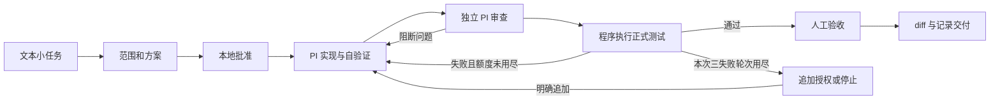

# ForgeLoop 最小架构

日期：2026-10-12，Asia/Shanghai。状态：快速启动架构草案，尚未实现。当前只描述 ForgeLoop；公共方向沿用 [ADR](adr/0001-orchestration-and-executors.md)，具体范围以[首版需求](product-requirements.md)为准。

## 1. 只建设当前闭环

| Module／Adapter | 首版职责 |
| --- | --- |
| CLI | 输入、明确批准、状态／报告查询、请求停止与简单备份 |
| ForgeLoop 业务图 | 直接用 LangGraph 串起方案、批准、实现、审查、测试、验收和失败授权 |
| Python PI Adapter | 启动／观察容器 PI RPC、保存会话与可取得事件、取得结果并请求停止 |
| 本地记录 | 任务与配置快照、批准与失败、实际命令输出、候选 diff 与报告；持久检查点 |
| 受限执行环境 | 独立代码副本、PI 工具与实际测试命令；保留现场，不开放实际 main 与生产凭据 |

首版不创建 Web 服务、邮箱服务、队列服务、版本发布服务或公共平台包。各角色复用同一个 Adapter，保持必要的执行器 Seam，不提前设计厂商插件注册或自研执行循环。

## 2. 最小业务图

该图是顺序实现建议。失败分类、累计工时与本次授权检查也约束返回路径。第一次批准合并范围和方案的往返；第二次批准验收实际结果。交付之后用户人工接回 main 和上线，不接自动运维图。

## 3. 最小持久化

直接使用 LangGraph 的现成持久 checkpointer，并保存小量本地任务／决定记录与文件。首版是单节点研发工具，可优先验证本地 SQLite 方案，不先引入常驻外部数据库；具体版本与一致性在最小技术方案核查。[LangGraph 持久化说明](https://docs.langchain.com/oss/python/langgraph/persistence)

图中只放推进所需状态与文件引用，不把全部原始日志重复塞进每个检查点。CLI 查询由实际记录生成，进程退出后仍可读取。

首次只要求保存批准、结果并避免盲目重放。发生中断时标记待核对，由用户处理；不承诺自动接回旧 RPC 通道、自动续跑所有工具或事务化恢复外部副作用。LangGraph 中断恢复可能重新进入节点，启动记录存在时必须检查，不能直接重发旧执行。[中断说明](https://docs.langchain.com/oss/python/langgraph/interrupts)

## 4. 一个 PI Adapter

Python 通过标准输入／输出 JSONL 管理容器内 PI RPC。只封装当前需要的运行、结果观察和请求停止，先固定并实际验证一组依赖版本。[PI RPC 文档](https://pi.dev/docs/latest/rpc)

- 保存命令／任务／会话身份，持续读取 stdout；stderr 单独保存。
- prompt 被接受不意味着任务完成；当前官方协议需观察 agent_settled 再校验结果，不能只看 agent_end。
- 启用持久会话与 PI 原生自动压缩，保留可取得原始条目；不使用无会话模式冒充可回查执行。
- 开发与审查会话独立。正式测试由程序运行批准命令，记录实际退出码和输出。
- 请求停止后核对真实状态；异常或不明确结果不自动重跑，不伪装已暂停。

结果用一个小结构表达完成、成果与未解决事项，业务图结合实际测试和正式批准决定推进。费用数据取可得到的信息，首版不做计费网关和自动模型备用链。

## 5. 容器与 main

完整 PI 与研发命令在受限容器内执行，使用独立工作副本。PI 工具权限取决于进程权限与开放资源，需要实际验证，不能把 cwd 当作隔离。[PI 隔离文档](https://pi.dev/docs/latest/containerization)

首版可采用独立 clone／代码副本，或验证过 Git 元数据权限的 detached HEAD worktree。不得通过共享可写 Git 引用让容器直接修改真实 main；候选 diff 与基线记录交给用户验收并人工接回。工作区与会话持久保留，由用户清理。

首版既无生产发布，也不提供生产凭据、宿主 Docker 管理接口或任意宿主修改权限。工程依赖按已批准最小环境准备，实际测试就在该环境运行。

## 6. 备份与共享方向

完成任务后手动备份到独立挂载硬盘并核对可读取。持续备份、关键动作确认与灾难恢复保证在 B13，不让这些保证成为开发闭环的隐含完成声明。

两项目仍沿用统一 LangGraph 与 Adapter 方向、各自业务图和数据。先在 ForgeLoop 直接使用框架，第二个真实调用方出现重复后再抽共享包；不先实现另一个项目，不先建设统一控制服务。自研 Runtime、其他框架与执行器均后置。

## 7. 实施前只需核查的选择

最小技术方案明确 CLI 组织、本地持久化、PI／LangGraph 版本、容器与 Git 隔离、一个模型配置和真实测试命令。之后立即验证一条真实调用，不先解决后置清单中的邮件身份、版本后缀、自升级迁移或多节点。
