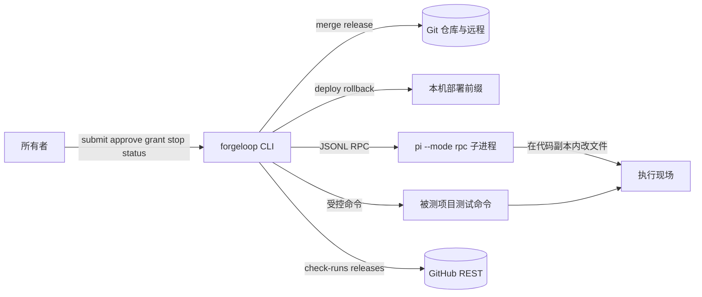
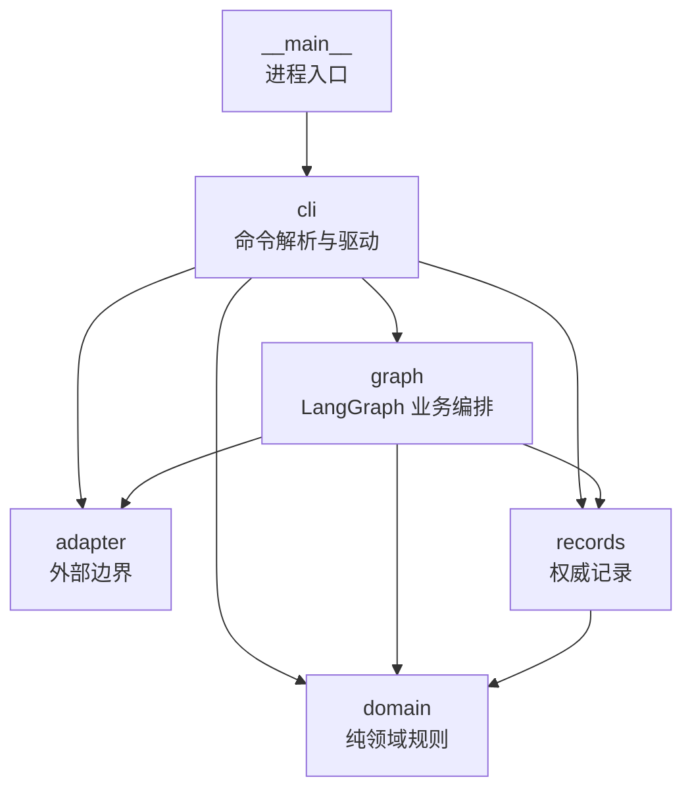

# ForgeLoop 架构说明

本文描述 **`src/forgeloop` 已实现的实际架构**：分层、模块职责、依赖方向、业务图、持久化与外部边界。它不描述尚未实现的设计意图，也不记录当前验证数字。

| 想知道 | 看哪里 |
| --- | --- |
| 架构长什么样（已实现） | 本文，以及机读快照 `contracts/architecture.json` |
| 为什么这样选（方向性决策） | `docs/adr/` |
| 首版做哪些需求 | `docs/product-requirements.md` |
| 现在跑到哪一步、验证数字 | `docs/status.md` |
| 工程门槛与统计口径 | `docs/engineering-reliability.md` |
| 领域词义 | `CONTEXT.md` |

**维护义务（强制）**：架构变化必须与本文、`contracts/architecture.json` 在同一次改动中同步更新。该义务由 `scripts/export_architecture_contract.py --check`（`make check` 的一环）机器强制；判定标准与流程见第 9 节。

## 1. 系统上下文

ForgeLoop 是单用户、单任务的本地 CLI 工具。操作者是任务所有者，负责两次批准（方案／验收）与追加授权决定。

外部系统共六类，都是真实外部边界，不是可忽略的实现细节：PI RPC 子进程、git CLI 与真实仓库、GitHub REST（匿名）、本机部署前缀（符号链接＋独立 venv）、被测项目的测试命令进程、系统时钟。

## 2. 分层与依赖方向

包按职责分五层，外加进程入口。层是**物理目录**，不是抽象概念：模块名形如 `forgeloop.<层>.*`。

允许的依赖方向（`scripts/export_architecture_contract.py` 的 `LAYER_RULES`；机读事实见 `contracts/architecture.json` 的 `layer_edges`）：

| 层 | 允许依赖 | 实际跨层边 |
| --- | --- | --- |
| `(root)`（顶层包） | 无 | 无 |
| `__main__` | `cli` | → `cli` |
| `cli` | `graph`、`adapter`、`records`、`domain` | → `graph`、`adapter`、`records`、`domain` |
| `graph` | `adapter`、`records`、`domain` | → `adapter`、`records`、`domain` |
| `adapter` | 无 | 无 |
| `records` | `domain` | → `domain` |
| `domain` | 无 | 无 |

三条硬规则，由门槛强制：

1. **`domain` 是纯规则层。** 不依赖任何内部模块、`langgraph` 或第三方编排库；已知的唯一内部依赖是 `domain.deploy` → `domain.release`（同层）。
2. **`adapter` 是叶子层。** 不 import 任何 `forgeloop.*`，只用标准库；适配器不知道领域规则与记录结构。
3. **模块依赖图无环。** 跨层与同层边一起检查。

`pyproject.toml` 的 `[tool.importlinter]` 另有一条 `forbidden` 契约，禁止 `forgeloop.domain` 依赖 `cli`／`graph`／`adapter`／`langgraph`。本文的 `LAYER_RULES` 是覆盖全部层的更完整版本。

## 3. 模块清单

| 层 | 文件 | 职责 |
| --- | --- | --- |
| 顶层 | `src/forgeloop/__init__.py` | 包声明，无逻辑 |
| 入口 | `src/forgeloop/__main__.py` | `python -m forgeloop` 入口，转调 `cli.main` |
| domain | `src/forgeloop/domain/__init__.py` | 层声明与分层契约指向 |
| domain | `src/forgeloop/domain/counting.py` | 失败轮次账本 `GrantLedger`：按 `round_id` 幂等计数、每次授权 3 轮、追加授权累加不清零 |
| domain | `src/forgeloop/domain/status.py` | 任务状态 → 下一步动作的纯映射：动作、主体（user／agent）与阻塞／等待原因；未知状态落到人工核对 |
| domain | `src/forgeloop/domain/requirement.py`
| domain | `src/forgeloop/domain/artifact.py` | 候选产物身份与校验规则：wheel 文件名 + SHA256、同一候选重复构建的一致性判定、未授权提交拒绝 | | 需求身份与版本规则：`req-<project>-<seq>` 项目内唯一、原文本与追加版本不可覆盖、未知身份明确失败 |
| domain | `src/forgeloop/domain/limits.py` | 执行时间账目 `ExecutionBudget`：只记实际执行耗时、超限停止启动新动作、显式延长 |
| domain | `src/forgeloop/domain/approval.py` | 方案 `Plan` 与批准 `Approval`：批准绑定任务身份与方案版本，一次批准只能触发一次执行 |
| domain | `src/forgeloop/domain/commit_policy.py` | 提交时间策略与年度工作日历判定、Conventional Commits 首行校验 |
| domain | `src/forgeloop/domain/merge.py` | 归并就绪判定与必需检查判定（候选分支 → 检查 → 快进 main） |
| domain | `src/forgeloop/domain/release.py` | 发布就绪判定、版本标签解析、发布记录 `ReleaseRecord`、同标签幂等／换标签拒绝 |
| domain | `src/forgeloop/domain/deploy.py` | 部署与回滚就绪判定、`SHA256SUMS` 解析、产物唯一选择（拒绝重新构建） |
| records | `src/forgeloop/records/__init__.py` | 层声明 |
| records | `src/forgeloop/records/store.py` | `RecordStore`／`OutcomeStore`：SQLite 12 张表的权威业务记录，读时重建领域对象 |
| records | `src/forgeloop/records/actions.py` | `ActionStore`：动作启动/完成身份与单任务并发占用；未完成动作拒绝重放 |
| records | `src/forgeloop/records/requirements.py` | 需求记录的读写：提交原文、追加版本、按身份与项目回查（进程重启后仍可读） |
| adapter | `src/forgeloop/adapter/__init__.py` | 层声明 |
| adapter | `src/forgeloop/adapter/pi_rpc.py` | `PIProcess`：JSONL RPC 子进程、命令／响应 id 关联、`agent_settled` 判定、abort、会话与 stderr 落盘 |
| adapter | `src/forgeloop/adapter/test_runner.py` | `run_test_command`：以 argv＋`shell=False` 运行批准的测试命令，证据追加 JSONL |
| adapter | `src/forgeloop/adapter/git_workspace.py` | 独立代码副本、基线 detached 检出、候选 diff 提取、受控归并与标签 |
| adapter | `src/forgeloop/adapter/github_checks.py` | 匿名读取提交的 check-runs，归一为「名称 → 结论」或 `pending` |
| adapter | `src/forgeloop/adapter/deployment.py`
| adapter | `src/forgeloop/adapter/artifact.py` | 候选产物构建与验证：真实 `uv build`（工作区内缓存）、独立 venv 安装、`forgeloop --help` 冒烟 | | 下载 Release 资产、独立版本 venv 安装、原子切换 `current`、冒烟检查、部署日志 |
| graph | `src/forgeloop/graph/__init__.py` | 层声明 |
| graph | `src/forgeloop/graph/state.py` | `TaskState`：只放路由与续跑所需的最小字段 |
| graph | `src/forgeloop/graph/nodes.py` | 八个节点工厂与 `NodeContext`：方案、批准门、实现、审查、测试、追加授权门、验收门、交付 |
| graph | `src/forgeloop/graph/evidence.py` | 失败回边证据读取：上一轮正式测试输出尾部与审查阻断问题（截断，供实现会话修复） |
| graph | `src/forgeloop/graph/prompts.py` | 提示词构造（纯函数）：开发提示（目标/范围/验收/工作区/尝试序号/批准测试命令/自验证要求/失败回边）与审查提示（含输出契约常量） |
| graph | `src/forgeloop/graph/builder.py` | 图装配：节点注册、条件路由、SQLite 持久 checkpointer |
| cli | `src/forgeloop/cli/__init__.py` | 导出 `main` |
| cli | `src/forgeloop/cli/common.py` | 记录根解析、`open_store`、`fail` 统一失败输出 |
| cli | `src/forgeloop/cli/main.py` | `submit`／`approve`／`grant`／`status`／`stop` 与参数总装 |
| cli | `src/forgeloop/cli/merge.py`
| cli | `src/forgeloop/cli/candidate.py` | `candidate build` / `candidate verify`：构建候选产物、记录身份与校验值、独立环境验证 | | `merge`：候选分支流程与归并证据 |
| cli | `src/forgeloop/cli/release.py` | `release`：annotated tag 与发布回执 |
| cli | `src/forgeloop/cli/deploy.py` | `deploy`／`rollback`：从 Release 装产物、原子切换、回滚 |

CLI 对外命令共九个：`submit`、`approve`、`grant`、`status`、`stop`、`merge`、`release`、`deploy`、`rollback`。`status --json` 的输出结构是对外契约，由 `contracts/cli-contract.json` 快照守住。

## 4. 研发闭环业务图

`graph` 层用 LangGraph 装配一条顺序主链，加失败回边与两个批准门。拓扑以 `src/forgeloop/graph/builder.py` 为准。

节点职责与状态字段：

| 节点 | 职责 | 写 `TaskState` |
| --- | --- | --- |
| `plan` | 由任务配置生成方案并落库，等第一次批准 | `plan_version` |
| `gate_plan_approval` | 第一次批准门；用领域批准绑定校验消费批准 | `halted_reason` |
| `dev` | 在代码副本内由 PI 实现并自验证，产出候选 diff | `dev_attempts` |
| `review` | 独立 PI 会话审查候选 diff | `last_review_blocking` |
| `test` | 程序执行批准的测试命令；失败计一轮失败轮次 | `last_test_passed`、`needs_grant`、`failure_cumulative` |
| `gate_acceptance` | 第二次批准门（整体验收）；拒绝按同一候选轮次计数 | `acceptance_passed`、`needs_grant` |
| `gate_grant` | 额度用尽后等待明确追加授权 | `needs_grant` |
| `deliver` | 写交付报告与交付记录 | 无 |

条件路由共五个（`route_after_plan_gate`、`route_after_review`、`route_after_test`、`route_after_grant`、`route_after_acceptance`），**全部先检查 `halted_reason`，一旦置位即走 `END`**。这是「停止／中断后不再推进」的统一落点。

三类人工决定点通过 `langgraph.types.interrupt` 挂起，载荷是普通 dict，用 `kind` 区分：`plan_approval`、`grant_decision`、`acceptance`。CLI 用 `Command(resume={"decision": ...})` 恢复；决定词表是硬编码字面量（`approved`／`grant`／`accepted`），**其他任何值（含缺省）一律按拒绝处理**。

`TaskState` 只有 9 个字段、无 reducer，且节点一律使用 `NodeContext.task_id`，不读 `state["task_id"]`。原始日志、PI 事件与会话文件**不进检查点**。

## 5. 执行现场、隔离与 main

- **执行现场**：每个任务一个目录 `<records_root>/<task_id>/`，内含 `workspace/`（代码副本）与 `sessions/`（PI 会话与 stderr）。现场默认保留，由用户清理。
- **代码副本**：`prepare_workspace` 用 `git clone --no-hardlinks` 建立自有 `.git` 的副本，再以 detached HEAD 检出基线提交，不与源仓库共享任何可写对象。候选 diff 由 `git add -A` 后 `git diff <基线提交>` 得到，覆盖修改／新增／删除，**不依赖 PI 的文本自述**。
- **main 保护**：副本与容器不得直接改写真实 `main`。候选结果先经人工验收，再由 `merge` 以受控路径接回；`create_candidate_branch` 与 `merge_candidate_to_main` 都要求现场干净、HEAD 等于基线且位于 main。
- **PI 工具权限取决于进程权限与开放资源**，不能把 `cwd` 当作隔离。

**已知偏差（如实记录）**：受限容器隔离**尚未接入**，PI 目前直接宿主运行（与 `docs/status.md` 第 6 节同口径）。因此本节的「隔离」目前由独立克隆副本＋真实基线的 diff 提取实现，不由容器实现。

## 6. 持久化与记录

两类存储职责分离，都在 `<records_root>`（默认 `.forgeloop`）下：

| 存储 | 文件 | 内容 | 管理者 |
| --- | --- | --- | --- |
| 业务记录 | `records.sqlite` | 领域事实的**权威**记录（12 张表） | `records.store.RecordStore` |
| 图检查点 | `checkpoints.sqlite` | `TaskState` 的推进状态，`thread_id = task_id` | LangGraph `SqliteSaver` |

记录表：`tasks`、`plans`、`approvals`、`approval_consumption`、`failure_rounds`、`grants`、`budget`、`stops`、`actions`、`merges`、`deliveries`、`releases`。

**动作生命周期（B03）**：会产生副作用的节点动作（`dev`／`review`／`test`）启动前在 `actions` 登记 `started`，正常结束登记 `completed`。进程在动作中途被杀只会留下 `started`；同一任务再次推进时，未完成动作拒绝重放并标记 `interrupted`，保留现场待人工核对。`begin` 在 `BEGIN IMMEDIATE` 事务内检查后插入，同一任务同时最多一个未完成动作，并发启动只有一个能成功。

**写入语义（现状）**：连接以 `isolation_level=None` 自动提交，但关键读-改-写序列显式使用 `BEGIN IMMEDIATE`／`COMMIT`／`ROLLBACK` 事务：`create_task`（任务＋预算）、`consume_approval`（批准消费）与 `extend_budget`；`charge_budget` 用单条原子 `UPDATE ... consumed_seconds = consumed_seconds + ?` 累加，并发计入不丢更新。连接设置 `busy_timeout=5000` 以等待写锁；仍未启用 WAL。

原始材料**不进**记录表，只以文件留在现场；记录里保存路径与校验值：

| 产物 | 路径（相对任务目录） | 消费者 |
| --- | --- | --- |
| 候选 diff | `candidate.diff` | 审查、验收、归并 |
| 实现自述 | `dev-reports.jsonl` | 交付报告 |
| 审查结论 | `reviews.jsonl`、`review-report.json` | 验收 |
| 测试证据 | `test-run.jsonl` | 验收、交付 |
| 交付报告 | `delivery-report.json` | 用户 |
| PI 会话与错误 | `sessions/<task>-<role>.events.jsonl`、`.requests.jsonl`、`.stderr.log` | 回查 |

这些文件名是**跨层契约**：验收中断载荷对外暴露的就是这些路径，`merge`／`release` 依赖它们。改动文件名属于架构变化。

## 7. 外部边界与接缝

需要在真实环境验证的外部依赖（不能用替身替代结论）：PI RPC 子进程与真实模型、git CLI 与真实仓库、GitHub REST、uv／venv／pip 安装子进程、宿主符号链接与 `os.replace` 原子切换、被测项目测试命令进程、系统时钟。

可替换接缝的当前形态：

| 接缝 | 形态 | 替换方式 |
| --- | --- | --- |
| 执行器命令 | `config["pi_command"]`、`config["test_command"]` 快照 | 配置注入；测试用 `tests/fixtures/fake_pi.py` 讲同一 JSONL 契约 |
| 记录端口 | `NodeContext.store: RecordStore` | 构造注入（类型是 SQLite 具体实现，不是 Protocol） |
| 任务上下文 | `NodeContext`（`task_id`／`task_dir`／`workspace`／`sessions_dir`／`config`） | 闭包注入，不进检查点 |
| 外部服务地址 | `deployment.GITHUB_API`、`github_checks.CHECK_RUNS_API` 模块常量 | monkeypatch |
| 人工决定来源 | `interrupt` 载荷＋CLI `resume` | 换决定来源只需改 CLI 侧 |

**诚实的限制**：`adapter` 层**没有** Protocol／ABC 端口；`graph.nodes` 在模块级直接构造 `PIProcess`、直接调用 `run_test_command` 与 `prepare_workspace`；`build_graph` 也不接受可注入的 checkpointer。因此「在进程内替换执行器」目前要改 `graph/nodes.py` 的调用点，而不是换一个实现类。保留的 Seam 是配置与函数参数，不是接口抽象——这是首版刻意选择的简单性，不声称已经是插件体系。

## 8. 交付链路：归并 → 发布 → 部署

研发闭环之外，`cli` 另有三个受控阶段，规则在 `domain` 的 `merge`／`release`／`deploy`：

关键不变量：**部署必须使用验收过的那一份产物**——`deploy` 校验 `SHA256SUMS`，校验值不匹配即拒绝，禁止重新构建；同版本不同产物被拒绝；`release` 对同标签幂等、换标签拒绝。

## 9. 架构变更与本文同步

### 什么算架构变化

- 模块的新增、删除、改名或换层；
- 跨层依赖方向的新增、删除或改变；
- `LAYER_RULES` 允许依赖表的改变；
- 业务图节点增删或拓扑／路由改变；
- 持久化介质、记录表结构或现场产物文件名的改变；
- 外部依赖系统的新增或替换、接缝形态的改变。

同层内部重构且不改变任何边时不算架构变化，但契约快照仍必须保持一致。

### 变更时必须做的

1. 在同一次改动中更新本文（至少第 2、3 节的层与模块清单）与 `contracts/architecture.json`；
2. 运行 `make architecture-contract` 重新导出快照，再运行 `make check`；
3. 方向性选择（换编排框架、换执行器、改变分层）另写 `docs/adr/` 决策记录——ADR 只回答「为什么」，本文回答「现在是什么」。

### 机器如何强制

`make architecture-contract-check`（含在 `make check` 内）从源码 AST 重新推导事实，与快照和本文比对，任一不符即失败：

1. 模块新增、删除或换层；
2. 跨层依赖边变化；
3. 越层依赖（违反 `LAYER_RULES`）；
4. 模块之间出现 import 环；
5. **本文第 3 节的模块文件路径与源码模块集合不互为镜像**——漏写新模块或残留已删除模块都失败。

第 5 条是「架构变化必须同步架构描述文档」这条规则的执行点：只要改了模块结构而没改本文，`make check` 就会失败并指出缺失或多余的路径。
