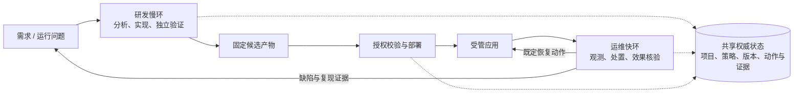

# 独立服务器上的自主研发与应用伴生运维：场景分析草案

日期：2026-10-21，Asia/Shanghai。

本文依据所有者本轮明确的两个场景重新分析目标：独立服务器接收目标并自主完成研发、验收与部署；伴生系统持续观测受管应用，自动处置运行故障，需要修改时转入研发并交付修复。本文是方案研究，**不改变现行批准、验收、提交和部署规则，不表示目标能力已实现**。DSH 插件、个人工具与多人分布式协作均不作为预设产品形态。

## 1. 核心判断与定位

两个场景可以组成同一产品：**部署在独立服务器上的自主研发与运维控制系统，围绕受管应用的目标、版本和运行效果，持续完成交付与恢复。**

第一场景负责把目标变成经验证、上线后有效的软件变更；第二场景负责维持服务健康，并把运行证据转化为后续改进。它们共享项目身份、执行授权、版本、动作回执和证据，具有不同的响应节奏与风险：研发可以耗时较长并在隔离环境反复试验，线上处置应先限制损害，在明确的时间和操作范围内完成。

这个目标具有工程和产品价值，也有真实研究空间。当前证据支持在限定应用、明确验收与可恢复部署条件下建设并逐步扩大自治；没有证据保证任意模糊需求、任意遗留系统和任意生产事故都能由模型自行正确解决。应把“无需人逐步操作”作为目标，把“对无法证明安全、正确或有权执行的动作采取什么行为”作为产品能力，而不是隐去失败。

ForgeLoop 的核心价值不是重新实现模型和工具循环，而是把**目标、行动、证据、发布和运行反馈**连成可持续的业务闭环。PI、DSH 等 Agent Runtime 是执行能力来源，可根据实测替换；是否提供 DSH 插件是入口和分发选择，不决定核心的权威状态与常驻方式。

下面是目标逻辑图，不是当前实现声明：

## 2. 用户、目标来源与责任边界

即使研发过程中没有人逐步参与，系统仍有用户和目标来源：

| 参与者 | 提供什么／获得什么 |
| --- | --- |
| 应用所有者／业务负责人 | 提供业务目标、损失容忍度、运行约束及初始授权；获得可用功能、稳定服务与结果记录 |
| 应用使用者 | 通过真实使用、反馈与业务结果表达问题；反馈不是修改或发布授权 |
| ForgeLoop 管理者 | 登记受管项目、环境、凭据边界和规则；接收系统无法自行收敛的异常，不必逐任务批准 |
| 受管应用与基础设施 | 提供受约束的观测和动作接口，接受版本与配置；其输出可能错误、过期或被攻击者控制 |
| 自主研发与运维执行者 | 在有效项目契约内选择方案、执行和验证；不能自行扩大自身权限或改写所有者目标 |

因此，首批适用用户可以是拥有明确应用责任、能提供可测试业务目标和部署权限的个人、组织或研发团队。人员数量不是首要分界；**是否能控制受管应用、提供可靠验收及界定操作后果**，比团队规模更决定能否实现无人值守。

不宜把“给一句愿望后，系统自行决定全部业务含义”作为首版承诺。对可恢复、低成本且不改变外部承诺的细节，系统可以按项目约定自行选择并记录假设；对会改变数据使用、收费、访问权限或不可逆业务结果的歧义，应由既定默认规则决定，缺规则则标为未解决。等待外部信息不是完成。

## 3. 一手证据能支持什么

以下文献用于界定可行性与验证方法，不将其结果当成 ForgeLoop 的性能保证。论文固定到实际阅读版本；工程文章与文档按本次读取日期理解。

| 一手材料 | 观察与适用边界 | 对本项目的作用 |
| --- | --- | --- |
| [HoH，arXiv:2609.01481v1，2026-09-01](https://arxiv.org/html/2609.01481v1) | 跨模型基准与 70 轮 Godot 案例支持持续规划、代码继承和独立 QA 的作用。案例人工仅恢复网络/API；截止时 81 个问题有 16 个未解决，17 个曾重开。 | 自主长周期构建有具体证据；不能推成商业应用、数据迁移和生产运维已全面解决。 |
| [Anthropic：Harness design for long-running application development，2026-03-24](https://www.anthropic.com/engineering/harness-design-long-running-apps) | 报告多小时应用构建；自评存在宽松偏差，独立 Evaluator 仍需校准。不同模型需要不同流程，案例不是普适成功率。 | 保留可执行验收与独立检查；任务颗粒度和 QA 频率通过实测调整。 |
| [AIOpsLab，arXiv:2501.06706v1，2025-01-12](https://arxiv.org/html/2501.06706v1) | 在真实微服务、负载和可注入故障中，区分检测、定位、根因与缓解，并由任务侧评价结果；初始受测模型较旧。 | 借鉴受控故障、实际服务恢复和连带影响的验证方式，不用旧成功率预测当前模型。 |
| [SRE-Marathon，arXiv:2609.33023v1，2026-09-26](https://arxiv.org/html/2609.33023v1) | 持续噪声告警与重叠代码/配置故障下，10 种方法最佳 41.3/100，修复仍是瓶颈；该分数不是修复率。每轮约 90 分钟、故障密度刻意偏高，主环境为单宿主 Kind，受测两个经济型模型不是最强模型。 | 检验长跑中的真实恢复、累计错误和用户损害；不能据此宣布所有模型都无法自治。 |
| [Google SRE：The Evolution of Automation at Google](https://sre.google/sre-book/automation-at-google/) | 明确界定的自动操作可以比逐次人工放行更一致、更快，自动化也会放大错误。 | 自治目标合理，需将动作限制在已定义领域内；不必把每个动作重新设计为人工按钮。 |
| [Google SRE Workbook：Canarying Releases](https://sre.google/workbook/canarying-releases/) | 测试环境无法覆盖全部生产行为；部分、限时上线与评价可以限制不良版本的影响。 | 将生产效果回查、推广与回退纳入交付，不能以部署命令成功结束。 |
| [Kubernetes：Controllers](https://kubernetes.io/docs/concepts/architecture/controller/) | 控制器持续比较期望与实际状态，执行动作并回报观察；各控制器管理明确职责和资源。 | 采用调谐与动作核对思路；并不要求本项目引入 Kubernetes。 |
| [SQLite：Appropriate Uses](https://www.sqlite.org/whentouse.html) | 允许应用服务持有服务器本地数据库，网络客户端通过业务请求访问；多机直接共享数据库文件并不合适。 | 独立服务器上的本地 SQLite 不构成场景障碍；遥测与并发规模需单独评估。 |

这些证据分别覆盖长任务构建、自动运维实验与成熟控制方法。它们尚未合起来证明一个系统可以无限期、无监督地交付任意软件。ForgeLoop 需要自己的真实应用、固定版本和失败记录。

## 4. 场景一：从目标到运行效果的自主研发

完整闭环应当是：

> 接收目标 → 核对项目契约与可执行性 → 形成需求和验收依据 → 评估架构与拆分增量 → 隔离实现 → 独立检查与真实测试 → 构建并识别候选 → 受控上线 → 观测业务与运行效果 → 完成或退回修复。

各阶段都应产生下一阶段实际消费的对象，而不是只产生一段 Agent 宣称。例如：需求修订必须可追溯到原目标；验收必须引用确定候选及真实运行证据；部署必须指定同一构建产物；完成必须引用上线后的验证结果。

### 4.1 自行判断需求与架构

系统可以在有效目标内自行补全界面细节、任务顺序、实现方式和技术方案。架构判断至少检查：现有边界与约束、目标负载和可用性、数据与外部接口兼容、改变范围、迁移与撤回条件。对普通局部修改，不必每次组织完整架构评审；触及数据模型、公共接口、凭据、部署拓扑或系统规则时提高所需证据。

架构质量不能只由模型打分或循环/复杂度指标判定。应先给出具体质量场景，例如“在发布响应丢失后重启，不重复迁移数据库”，再选择依赖检查、状态机 PBT、故障注入、负载测试或真实变更分析。指标可以支持决策，不能代替业务目标或掩盖权衡。

### 4.2 长时间执行与任务分配

任务单元以可验证且依赖清楚的增量为界；并行用于可独立实现和验证的工作，集成、共享环境与上线由统一机制协调。模型擅长连续完成的相关修改可以在一个执行现场推进，无需固定每个功能都重建会话或走相同仪式。

跨会话保存当前代码、计划依据、未解决问题、已验证行为和下一步，不把全部历史塞回上下文。预算计算包含失败和返工；重复尝试、外部服务故障和需求变更不能悄悄清零。系统不能把制造更多子任务、测试或文档当作交付进展。

### 4.3 验收的真正难点

无人逐步参与并不等于由开发 Agent 给自己判定“通过”。建议形成三层判断：

1. **基础不变量**：候选身份、授权范围、预算、数据兼容和安全边界由确定性机制检查。
2. **场景行为**：黑盒端到端、真实接口、状态和回归检查验证业务行为；开发者不能删除、跳过或放宽权威验收标准使自己通过。
3. **开放质量判断**：体验、业务合理性和架构取舍可由独立 Agent 提供有证据的评价；评价不确定或分歧时保留未知，不能伪装成客观事实。

独立指上下文、权限、版本和证据路径隔离，不天然意味着模型错误相互独立。换模型可以减少部分共同偏差，但不能解决需求本身错误。验收器可以新增探索性测试；需要修订权威标准时，应走单独规则，保留依据，禁止开发者直接改变裁判。

系统应能区分：实现完成、检查通过、上线成功、效果确认，以及失败、未知和超出能力范围。回滚恢复了服务不表示原需求已交付。

### 4.4 首批自治范围应由验证能力决定

| 需求类型 | 可以怎样验证 | 起步判断 |
| --- | --- | --- |
| 已有服务的可复现缺陷 | 旧候选明确失败、新候选通过，同期回归和上线探针有效 | 适合优先验证，仍需防止用改变预期来掩盖缺陷 |
| 已有接口内的兼容增强 | 有明确业务例子、接口契约与数据不变量，并可验证部署效果 | 可在限定范围内全程自主推进 |
| 全新且含糊的产品目标 | 系统可形成需求假设和原型，但代码与自评不能产生缺失的业务偏好或市场反馈 | 可以自主探索，不能预先保证最终业务验收 |
| 不兼容数据迁移或不可逆外部操作 | 需要迁移协议、可核对回执和恢复证据，普通测试与代码回滚不足以覆盖 | 单独建立自治策略，不随一般编码任务默认放行 |

## 5. 场景二：运维先恢复，研发解决根因

完整闭环应当是：

> 持续观测 → 判定信号可信度与事件关联 → 形成事件 → 限定影响并执行可用处置 → 验证恢复 → 必要时提交可复现问题 → 自主研发 → 上线验证 → 关闭或继续跟踪。

### 5.1 研发慢环与运维快环

| 环路 | 主要责任 | 不应承担的责任 |
| --- | --- | --- |
| 运维快环 | 健康检查、抑制与归并、确定性恢复、限流/隔离/开关/回滚、持续效果验证 | 每个告警立刻派生代码任务；无界尝试命令；以重启次数当成功 |
| 研发慢环 | 复现缺陷、分析根因、改变代码/配置/测试、独立验证、交付新版本 | 在故障压力下直接编辑生产代码；仅凭告警消失宣布根因修复 |
| 共同控制 | 有效授权、环境与版本身份、动作互斥、预算、事件/问题/发布关联 | 两套循环各自保存“当前生产版本”并作出相互冲突的决定 |

“快”和“慢”是责任与时限差异，不等于所有运维动作都更容易。某些跨数据库或跨区域故障比普通研发复杂。应该先保证应用原有的进程监管、健康检查与已知恢复方法不依赖在线模型；Agent 负责已有规则不能处理的分析和候选方案。

### 5.2 何时进入研发

运行时配置漂移可能按已知期望配置恢复；单个进程异常可按限制重启；新版本回归优先切回已知兼容版本。若需要修改代码、持久化结构、业务规则或非既定配置，则创建关联问题单进入同一研发流程。

问题单至少携带：项目/环境/版本、观测时间窗、用户影响、相关变更、日志与指标引用、已试动作及回执、复现方法或证据缺口、修复后的预期行为。敏感数据应以受控样本或引用传递，不能把全量生产数据复制到研发现场。

事件恢复与缺陷修复分别记录：回滚后事件可以恢复，根因问题仍开放；修复代码上线后必须验证原故障和相关回归；只是等待故障自然消失不能计为自动修复。

### 5.3 防止处置循环和反馈失真

同一故障可能产生数百告警，因此需要稳定事件身份、去重、时间窗归并、冷却、有限尝试和项目级总预算。根因关联可以使用模型建议，但应保留原始信号及不确定性，避免把所有异常过度合并。

运行控制应明确优先级：事故处理可以暂停普通部署；同一应用不能一边被回滚一边推广新版本；一个生产环境同一时刻只有一个拥有有效动作身份的变更。冷却期内继续收集证据，不继续重启。达到损害阈值或失败上限时，熔断进一步副作用，保留可用旧版或按预定策略降级，并记录未解决。

观测系统本身失败、日志缺失和网络不可达应表示“未知”，不能等同健康。要防止通过删除日志、降低告警阈值、关闭关键检查或修改指标分母来制造“恢复”。监控改动也是有版本和独立验证的变更。

### 5.4 一条贯通两个场景的示例

假设某服务上线后，特定合法请求开始返回 500。系统先关联请求探针、日志和部署版本，确认实际用户影响；若满足回退策略且数据兼容，就自动切回已知稳定版本并验证恢复。随后创建引用故障版本、请求样本、失败证据和已尝试处置的问题单，进入研发慢环。

研发侧在隔离现场复现：故障版本确实失败，修复候选通过同一检查，相关既有行为也通过独立验证。固定产物交给发布流程，分阶段上线后再次执行原请求与业务检查，观察服务指标，再决定推广、回退或继续诊断。上线前若基线或目标环境改变，先重新核对候选和证据，不能直接沿用旧结论。

整个处理可以没有人工逐步操作，但记录必须区分“回退恢复了事件”“代码缺陷已经修复”和“修复版本已在运行中确认”。同一告警反复出现不会不断创建重复研发任务；诊断错误或修复失败则保留未解决事实，按既定策略停止进一步副作用。

## 6. 无人介入依赖事前契约和机器授权

建议把目标定义为：**一次接入与授权后，系统在明确业务领域和损失边界内持续自主运行，正常路径无需人在每一步作决定。** 这允许系统自行设计、实现、验收和发布，也允许事先约定的失败路径自动回滚或停止。

初始项目契约应包括：目标与禁止事项、合法需求来源、仓库与环境、受保护接口与数据不变量、验收入口、允许的运维动作、上线窗口和流量范围、成本/时间/失败限额、兼容与备份条件、错误预算、未知结果核对方式和停止/恢复规则。内容按当前场景最小化，不为未来假设建设复杂规则语言。

每次动作在入口核对有效契约、环境、版本、作用范围和额度，并持久记录授权依据。模型可提出授权范围内的动作，不可以把自己写成 `owner`、复制人工批准、扩大额度、改写失败记录或更新授权策略来放行自己。

这与现行“人工逐项批准和验收”是实质不同的业务策略。本文仅提出未来可执行预授权方向；落地需要明确方案、强制机制及通过/拒绝行为验证，不能在一次分析中删除现有门禁。

对于用户“全程无人参与”的要求，应分别报告：受管范围内自动完成率、自动止损率、失败/未知率、仍需外部决定的原因。停止是一种正确控制行为，但不计为需求成功完成。

## 7. 发布、灰度与数据变更

一次候选应由代码、依赖/构建输入、产物摘要、配置、适用数据结构和验收结果共同识别。开发分支、`main` 或标签名称不能单独代表实际运行对象。验收后重新构建、部署另一份字节或改变关键配置，都需要重新判断证据适用性。

自动部署至少分为预检、安装、激活、健康与业务验证、观察、推广或回退。灰度需要流量分配、可比较的信号与足够观察窗口；低流量应用可能无法及时获得统计证据，应使用影子请求、合成业务检查或更保守的推广策略，不能把“没有告警”当作强结论。

代码回退不代表数据可回退。数据库删除字段、改变语义或写入不兼容数据后，旧程序可能无法继续运行。首批自治范围宜限制为已验证的兼容变更；需要迁移时，分别验证旧/新程序兼容、分阶段扩展与收缩、备份可恢复性、迁移身份与重试行为。无法证明可回退的迁移应进入单独策略，不能以万能 `rollback` 承诺覆盖。

远程动作发送成功与执行完成不同：部署可能完成而回执丢失。应先持久登记动作身份和目标产物，使用远端可查询回执与实际版本核对。得到“已完成”则补记；确定未执行才按规则重试；仍未知则冻结相关变更。仅增加消息重试无法保证外部副作用只发生一次。

## 8. 单服务器形态、状态与故障域

独立服务器正好提供一处业务权威，不需要把各开发者的本地数据库合并。服务器持有项目记录、动作账、候选证据和发布事实；应用可以同机或在远端，远端通过受认证的观测/动作协议交换事实，不直接读写服务器 SQLite 文件。[SQLite 官方部署说明](https://www.sqlite.org/whentouse.html)

推荐先保持单节点业务核心，沿用现有持久化与执行接缝，不因“自主系统”就引入微服务、消息集群和多主数据库。日志、指标等高吞吐时序数据宜由既有可观测工具保存，ForgeLoop 保存与事件相关的引用和证据快照，而不是把全部遥测写入业务库。

同一服务器上仍应区分控制进程、研发工作区、验收环境和部署动作。研发进程可能耗尽 CPU、内存、磁盘或模型额度，不能因此阻塞生产保护；需要资源限额、磁盘保留、并发限制和独立凭据。开发 Agent 不取得通用生产 shell，生产动作经过有限接口；能调用 Docker socket 等特权接口也必须按其实际权限处理。

单服务器有共同故障域：主机断电、磁盘损坏和网络故障会同时影响编排与观测。最低限度需要可恢复备份、明确恢复步骤、宿主级监管与外部存活探测。离线时应用已有确定性保护继续执行；不能联系权威节点时，不擅自推出新版本。以后是否高可用，依据恢复时间目标和真实损失判断，不用无限自治的宣传替代物理限制。

## 9. 三种“自”必须分清

| 类型 | 含义 | 验证与边界 |
| --- | --- | --- |
| 受管应用自修复 | 应用出问题后，伴生系统处置或研发并交付修复 | 证明应用实际恢复、缺陷复现转通过、相关行为不回归 |
| ForgeLoop 自升级 | ForgeLoop 将自身作为一个受管项目，改变并部署自己的版本 | 独立验收和外部启动/回滚入口；升级中的版本不能同时修改自己的放行规则 |
| 模型自学习 | 更新模型权重或训练策略 | 本目标无需训练模型；积累规则、用例与经验不等于模型完成自学习 |

自升级应比应用升级更保守：运行中的控制器失效不能使恢复工具一起消失；保留已知版本、兼容状态和由独立进程执行的激活/回退。数据库升级尤其需要避免新版本写入旧版本不能读取的状态后，声称切换符号链接即可恢复。

反馈、日志、Issue、依赖文档与受管仓库都属于可能含攻击内容的数据。它们可以帮助诊断，不能提供权限或改变系统指令。授权、凭据、验收器和部署执行根应位于开发 Agent 无法改写的边界；单纯提示词要求忽略恶意文字不构成强制隔离。

## 10. 当前实现与目标的距离

以下以当前源码与状态记录的较新批次为依据；状态文档开头和旧缺口表保留的部分描述已经滞后，不据此否认后续交付。

| 范围 | 当前证据 | 目标缺口 |
| --- | --- | --- |
| 需求/任务/交付 | 已有需求规划、独立现场、PI/DSH 执行接缝、真实测试与材料绑定 | 仍需要人工批准/验收；没有完整的可执行预授权与自动业务验收方案 |
| 常驻 | 已有 `serve`、worker、自动接续开关、断线推进、启动核对 | `auto_advance` 默认关闭；只续接已批准且下一步属于 Agent 的工作；未知副作用仍交人工核对 |
| 页面 | 常驻入口已有提交、批准、推进、验收、停止；不能再笼统称只读 | 回环监听、面向本机所有者；远程需求入口的身份和暴露方式需按场景设计 |
| 部署 | 10/20 较新批次记录真实 0.0.4 安装/激活/冒烟及 `systemctl --user restart` 后服务可用 | 这是 ForgeLoop wheel 的本机版本部署；不等于任意应用、灰度、数据库迁移或完整自动自升级 |
| 发布链 | Release→Deploy 的真实工作流路径可达，缺发布回执时会拒绝 | 一次由已验收产物完整驱动的 release→deploy 自升级仍需对应成功证据 |
| 应用伴生运维 | 当前核心围绕研发与交付 | 尚无完整的受管应用观测、事件归并、自动处置、故障转研发及效果回查闭环 |

源码入口：[worker](../src/forgeloop/graph/worker.py)、[服务配置规则](../src/forgeloop/domain/service.py)、[服务入口](../src/forgeloop/cli/serve.py)、[部署适配](../src/forgeloop/adapter/deployment.py)、[架构](architecture.md)、[状态记录](status.md)。现有积累可复用；距离目标的主要工作是自治决策与真实闭环，而非再添加一个 daemon。

## 11. 用真实业务逐步验收

以下是建议里程碑，不是本轮实施范围。每项都应固定应用基线、模型/Runtime、授权与预算、故障条件、成功判据、原始记录和实际外部介入。短期系统用例负责发现编排错误；结论必须再通过真实应用与模型验证。

| 里程碑 | 业务场景 | 必须观察到的结果／失败行为 |
| --- | --- | --- |
| M1 自主交付最小闭环 | 对一个已有、可测试应用提交低风险需求，事前给定契约，提交后不逐步操作 | 自动规划、实现、独立验证、部署、效果回查；错误候选不上线，失败保留旧服务并标未交付 |
| M2 已知运行故障自治 | 在受控真实环境触发进程退出或已知配置漂移 | 观察、有限处置、确认业务恢复；重复信号不重复派单，反复失败冷却并熔断 |
| M3 运维转研发 | 注入可复现的代码缺陷，不能只靠重启解决 | 自动携证据建问题、复现、修复、独立验收、上线确认；不能通过关闭告警“完成” |
| M4 连续运行与故障恢复 | 多天运行，混合需求与告警，刻意制造 API/网络中断及动作回执丢失 | 状态继承、预算不清零、未知副作用核对、无盲目重放，记录交付与未解决比例 |
| M5 自升级与状态兼容 | ForgeLoop 自身低风险改进 | 由独立恢复入口控制切换，坏升级可恢复；再逐步评估兼容数据迁移 |

对于测试期间的 API 付款、网络恢复、人工修改、外部脚本补救和人工验收要逐次登记。可以另外报告“业务步骤无人参与”和“基础设施无人参与”，不能把后者的人工恢复隐藏在前者的宣称里。多天只运行心跳也不构成 M4，需要真实需求、真实处置与失败路径。

建议同时报告：需求成功交付率、有效修复率、从需求到有效上线的时间、受影响请求或业务损失、错误上线/误处置、回归、重复副作用、总模型成本、人工介入及原因、未解决项。未知归类不能从分母删除。最好与同 Runtime 的直接执行和既有确定性运维比较，避免将多耗费预算得到更多输出误认为系统效率提高。

## 12. 对项目方向的建议

保留“独立服务器持续运行的自主研发与运维伴生系统”作为统一目标；把 DSH/PI 留在执行接缝，插件可以作为后续入口。优先做一个应用的一项真实需求，从输入到上线效果无人逐步介入，再扩展到已知运维故障和代码修复。

研发与运维共享权威状态，分别保持清楚的职责、时间预算和失败边界。对能机器判断的规则落实确定性强制；对开放判断保留独立证据与未知。不要把终极自治目标改写为每一步必须人工批准，也不要以删除现有人工入口和门禁来冒充自治已实现。

本轮范围仅新增本文；没有改变代码、现行 PRD、领域术语、架构契约或批准策略，没有运行真实研发、部署或提交。发现但不碰：状态文档早期表述与较新交付批次存在历史漂移，后续按实际实施范围整理。
