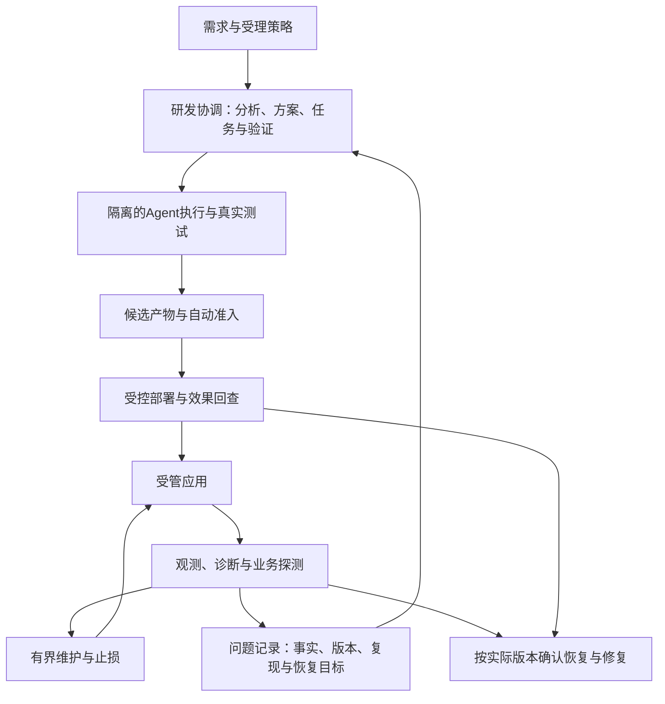

# ForgeLoop：自主研发与运行伴生双闭环场景分析

日期：2026-10-21，Asia/Shanghai。状态：**分析提案，未实施**。

所有者明确的主要场景：独立服务器上的系统接收需求，自行完成需求判断、架构、任务分配、实现、测试验收及部署，常规研发过程无需人参与；同时作为受管应用的伴生系统观测运行，自动维护，必要时提交研发问题并重新交付。

这与[AGENTS.md](../AGENTS.md)已有“独立服务器、持续运行的研发与运维伴生系统”目标一致。此前DSH插件与多人协作提案属于实现／产品形态探索，不应反过来替代本轮明确的主要场景。本轮不删除或重写这些草案，也不把它们当作已确认主路线。

以下架构、授权、验收和阶段划分均为建议，不能据此启动生产动作、放宽现有批准规则或声称无人闭环已完成。本轮只新增本文件。

## 1. 产品定位与判断

建议定位为：**部署在独立服务器上、以应用效果为依据的自主研发与运行伴生系统。**

它包含两个互相衔接的闭环：

- **研发闭环**：目标或问题 → 规格与验收依据 → 方案和任务 → 实现 → 独立验证 → 产物 → 部署 → 运行效果回查。
- **运维闭环**：运行观察 → 异常判断 → 诊断与止损 → 效果验证；需要持久代码变更时产生研发工作项，修复交付后再确认业务恢复。

前者改变系统能力与实现，后者维护运行状态并发现新的演化需求。两个闭环共享项目、版本、工作项、动作及交付身份，避免各自维护不同事实。

技术上存在可分阶段验证的路径，相关研究与工程实践提供局部证据；目前不能据此承诺任意需求、任意系统、任意故障均能无人完成。

## 2. “全程无人参与”的严格含义

建议保留所有者的自动化目标：输入进入后，在既定环境与策略范围内，系统自行分析、设计、实现、验证、发布、观察和处置，不依赖人工逐环节点击继续。

这不要求人每次批准方案或部署，但仍需要初始业务目标、项目／环境边界、可信输入来源、可执行判据与动作权限。系统可以在运行中检索、探测和试验补足信息；未能消除的关键歧义应明确保留。

自动判断可以产生：继续、修订方案、重试、降级、回退、拒绝、阻塞或停止。**自动判定无法完成是有效结果，但不能计为成功交付。** “无人值守”与“所有请求必定成功”是不同承诺。

初始授权和策略设定不等于每项任务的人工介入。反之，事后由外部工具改代码、人工修复环境、人工补做验收后才完成，均应如实计入介入，不包装成系统独立完成。

## 3. 场景一：自主研发系统

### 3.1 核心工作不是重复调用编码Agent

| 环节 | 系统需要判断的内容 | 可取得的依据与产物 |
| --- | --- | --- |
| 需求受理 | 来源、目标、项目、适用环境和是否属于可自主处理范围 | 原始输入、身份、项目配置、受理判定 |
| 需求分析 | 场景、业务规则、边界、未知和验收方式 | 结构化规格、假设、示例、约束与缺口 |
| 架构与方案 | 如何在现有系统中满足目标，影响哪些组件和数据 | 当前代码／配置、架构决定、备选方案及验证计划 |
| 任务分配 | 工作单元、依赖、执行现场、限额及交接 | 带身份和版本的任务包、前置产物契约 |
| 实现 | 候选是否仍在范围内，局部行为是否成立 | 隔离现场、真实改动、工具结果、自验证 |
| 独立验证 | 功能、业务不变量、回归与交付材料是否满足要求 | 程序测试、场景验证、独立审查、明确未知 |
| 自动准入 | 当前证据是否足够，是否允许构建／发布／部署 | 可机读策略及版本、判定理由、实际材料身份 |
| 部署与回查 | 实际运行的是否为已验证产物，业务效果是否满足条件 | 部署回执、实际版本、外部业务探测和观察结果 |

规划可滚动修订，不必一开始一次生成全部细节；每次修订需明确对目标、范围、任务和验证依据的影响，不能通过更换任务身份清除失败或隐含扩大授权。

### 3.2 最大难点是评价依据

系统可以检查实现是否符合给定判据，但判据是否准确表达人的真实业务意图，本身可能存在不确定性。自然语言需求、架构取舍和产品体验不总有可靠的二元答案。

模型可提出规格与测试候选，另一个会话可审查和实际操作应用；这些有帮助，但共享模型偏差仍然存在。应结合既有回归、业务不变量、已知输入输出、属性／变形测试、接口契约、原始数据与外部业务探测。

原始要求和既定判据的变更需要明确的规则与来源。候选实现不能自行削弱用于评价它的约束，以换取“验收通过”。合理的新测试和规格细化可以加入；改变业务含义、权限或验收基线应单独记录和判定。

### 3.3 架构决策也需要变成可检验的假设

AI可以自行提出模块、接口、数据模型与实现方式。对关键选择，应说明服务的场景、依赖假设及代价，必要时运行原型、负载或故障实验，记录为什么当前选择足够。

首期宜在熟悉技术栈与已有系统边界中扩展自主范围。架构图、目录结构或模型评分不能单独证明可维护性和业务正确；超出可观测、可验证范围时，应停止相应动作而非自动宣告合理。

## 4. 场景二：应用的运行伴生系统

### 4.1 观测对象需要包含实际业务

可组合进程与资源、日志与错误、请求／链路、实际部署版本、业务指标和外部合成交易。进程存活、HTTP 200或某条异常日志消失，都不足以单独判定应用正确。

异常输入应保留来源、时间与关联版本。日志、告警和外部反馈作为待核对的数据，不能直接当作具备执行权限的指令。重复和相互关联的告警需要归并到事件／问题身份，避免每次采样都触发一个开发任务。

### 4.2 先恢复，再消除根因

| 情况 | 自动响应的候选 | 是否进入研发 |
| --- | --- | --- |
| 已知且可验证的运行偏差 | 按预定义策略重启、切换、限流、关闭功能或回退 | 视是否重复、是否存在未消除原因决定 |
| 需要持久实现变更的缺陷 | 先维持已约定降级／稳定版本，保留现场 | 提交有复现与恢复目标的研发工作项 |
| 原因未知、外部依赖失效或证据不足 | 继续有界探测、停止扩大动作、保持可验证的处置状态 | 可提交调查项，但不推定改代码能解决 |

这些动作并非天然可执行；每个项目需要明确允许范围、次数、验证方式及失败后的行为。不能假定重启、扩容或回滚对所有系统都安全。

“服务已恢复”与“根因已修复”分别记录。回退到旧版本后，服务可能恢复，但研发问题仍未消除；修复代码后，若新版本未实际生效或业务尚未验证，事件仍不能关闭。

### 4.3 伴生系统提交的是研发问题，不是未经核对的修复命令

至少交接：项目／环境、实际运行版本与产物、异常时间窗口、影响场景、原始观察、已执行动作及结果、可取得的复现、根因假设、恢复目标、允许范围和仍未知的信息。

诊断假设与确定事实分开。研发系统应能推翻根因假设，也能判定当前无需代码修改；伴生系统的建议不能隐式扩大修改或发布权限。

## 5. 两个闭环如何可靠衔接

建议共享已有工作项、候选、动作与交付身份，不另造互不相通的事件单、修复任务和部署状态。

关键衔接规则包括：

1. **按受影响版本修复。** 修复基线应对应当前受影响发布；仓库最新提交不一定等于线上版本。
2. **发布前重新核对环境。** 运维止损期间可能已经回退、切换配置或部署其他修复；旧候选不能假设当前目标仍未变化。
3. **同一目标的发布和恢复协调。** 避免运维反复回退研发正在推进的新版本，或旧worker覆盖较新状态。
4. **重复输入幂等。** 告警、提交、领取和部署均有明确身份，重复投递不重复产生副作用。
5. **交付后回查原问题。** 使用对应版本及业务探测验证，达到声明的观察条件才完成问题关闭。
6. **无法确认时保持未知。** 实际激活成功但回执丢失，先核对运行状态，不盲目重放安装或迁移。

闭环不是“每一步工具返回成功”的串联，需验证上一环节的实际产物确实成为下一环节输入，最后的业务效果与最初问题相符。

## 6. 一个可选的概念架构

此图是职责建议，不是现有代码拓扑。项目规则、授权策略、记录和知识支持全部环节，但策略本身不因Agent输出而被自动放宽。

第一阶段可以沿用当前“一服务进程服务一项目”的范围，使用同机数据库与现场文件保存权威记录、检查点和产物。独立服务器上的集中协调无需先解决每位开发者本地数据库的多主合并。

受管应用与研发执行可以同机或分机；选择时应考虑资源和故障域。同机编译、测试或失控循环可能影响应用；无论怎样部署，研发环境不应默认获得全部生产权限。

DSH可以承担执行引擎、会话、工具和扩展接缝；其宿主也可能承载部分常驻职责。是否把协调器写成DSH插件，应看常驻、取消、恢复与故障处理能否验收，而非由分发形式决定。一次性headless调用不能直接充当完整常驻协调器，也不需要为此自研另一套模型工具循环。

## 7. 从人工批准转为自动准入

为了实现常规流程无人参与，建议研究“预先授权的自治范围＋逐次机器准入判定”，而不是让Agent冒充所有者批准。

| 策略内容 | 应明确的对象 |
| --- | --- |
| 受理范围 | 可信输入来源、项目、环境和可自主处理的工作类别 |
| 修改范围 | 仓库、组件、配置、数据结构与允许的迁移形式 |
| 验证要求 | 必须满足的不变量、场景、测试、证据与独立审查条件 |
| 运维权限 | 允许的动作、目标资源、重复限额及效果判据 |
| 时间与资源 | 执行时间、失败累计、计算／模型等资源限额与耗尽行为 |
| 发布条件 | 目标环境、实际产物身份、观察、放量、止损与纠正策略 |
| 不确定性处置 | 继续探测、保留现场、阻塞、降级或停止的条件 |

准入记录应表明依据哪个策略版本、适用什么对象、使用了什么证据、由什么机制判定；与人工批准来源区分。策略有变时需明确是否影响在途任务，而不是静默热更新。

本文不决定具体限额、允许的生产动作或自动批准范围，也不改变当前每版本人工部署批准。实际引入需单列方案，修改权威规则和执行入口，并验证通过／拒绝两侧。

## 8. 必须正面解决的工程难点

### 验收预言机与共同偏差

生成器、规划器和评估器可能共享同一错误前提。独立会话或换模型可以增加检查角度，但不能作为正确性证明。稳定程序、原始数据与真实环境结果应成为关键事实来源。

### 部署、数据与不可逆副作用

先构建并识别产物，再部署同一份已验证产物。分阶段发布与独立观察可限制影响，但是否能切分流量、是否有代表性负载，取决于应用。

代码回退不自动恢复数据库、消息、外部调用或已发生的业务动作。迁移兼容、备份恢复、向前修复与补偿需要分别设计；缺少这些能力时，不能默认该类变更允许自动发布。

### 无反馈不能当成功

业务指标断流、没有测试覆盖、缺少业务负载或观察时间不足，应显示未知或继续观察，不能以“没有发现问题”自动放量。也不能通过改告警阈值掩盖故障而关闭问题。

### 自动恢复与副作用核对

进程重启、外部超时、操作已生效但未落账，会使恢复成为独立问题。需要动作身份、持久状态和核对办法；无法确认完成情况时，不能为了保持自动化比例而盲目重试。

### 研发与运维相互干扰

同一应用的事件风暴、并发修复、配置切换及发布应共享协调依据，控制重复动作和陈旧结果。检测窗口、冷却和止损条件按实际系统定义，不固化普适数值。

### 控制系统自身失效

应用应能在ForgeLoop停止时按已定义方式继续运行或降级；控制机自身硬件掉电或网络全断不能仅靠同机Agent解决。要覆盖这些故障，需相应外部基础设施，不能隐含在“自愈”承诺中。

### 受管应用的自研发与ForgeLoop自升级

修复应用代码与修改ForgeLoop自身的调度、权限或验收机制是不同能力。后者影响控制和裁判，应后置并有独立于候选的验证、激活与回退依据。现有自我迭代记录不能自动证明常驻自升级、数据库迁移或故障后自治恢复。

## 9. 外部证据能支持到哪里

[Anthropic的长时应用研发实验](https://www.anthropic.com/research/harness-design-long-running-apps)展示多小时应用构建、规划与评估的作用，同时记录评估宽松、漏验和成本问题。它支持设计与验证机制值得研究，不能据此推断任意中大型系统可长期无人交付；具体任务是否需要额外编排，也应实测。

[AIOpsLab](https://www.microsoft.com/en-us/research/publication/aiopslab-a-holistic-framework-for-evaluating-ai-agents-for-enabling-autonomous-cloud/)提供微服务环境、负载、故障注入、遥测和任务评估。它可用于检验诊断与缓解能力，是评估框架，不是完整生产自主运维或需求到部署系统的交付证明。旧模型的实验成绩也不是当前能力上限。

[Google SRE：Canarying Releases](https://sre.google/workbook/canarying-releases/)说明部分流量、有限时间的发布评价及自动暂停／回退思路，强调指标、代表性负载和观察条件。它不能被解读为任意业务或数据库变更均可无损回滚。

以上来源提供局部机制和局限。本提案的双闭环组织、准入策略、实验选择与阶段划分是工程推论，本轮未复现这些研究。

## 10. 现有项目与目标的距离

只读核查的事实边界：

- 当前[worker源码](../src/forgeloop/graph/worker.py)已存在常驻推进、筛选、互斥和启动核对，但要求任务包已批准、无未核对动作，下一步由Agent执行；默认配置关闭自动推进，不代表本轮核查了现场开关。
- 当前[部署领域判定](../src/forgeloop/domain/deploy.py)检查部署批准及版本／产物匹配。因此，自主决策主要涉及授权和验收模型变化，不能只自动调用现有deploy命令。
- [状态记录](status.md)2026-10-19与2026-10-20条目记载了常驻服务和受控部署的真实验收／交付，包括0.0.4运行记录。本轮未连接实际服务器复验，也不能据旧条目把这些能力一概写成未实现。
- 原有人工方案、验收和每版本部署批准，与本轮目标的常规无人流程存在实质差距；需要独立方案处理，不能伪造人工决定。
- 本轮没有取得足以证明“目标应用观测→诊断→自动维护→研发修复→发布回查”完整闭环的证据，也未做全仓和全部原始记录审计。

状态文件包含不同日期的历史结论，引用需按批次和实际源码理解；本轮不修订其历史口径。

## 11. 建议的第一个联合验证

选择一个允许试验、具有持久数据且业务结果可自动核对的目标应用，例如异步任务服务。初始给出重复提交不重复执行、失败有界处理等业务要求、环境和预授权策略，然后记录无人常规介入下的全过程。

### A. 自主交付

从需求输入开始，系统自行形成方案、实现与独立验证，生成可识别产物，自动部署并由外部业务探测验证。所有人工补救和外部完成的步骤如实记录。

### B. 自动运行维护

持续业务负载，注入一种可按既定策略恢复的运行故障，观察发现、诊断、动作与效果核对；加入无故障对照，检查是否误修。

### C. 运维触发研发

再引入需要代码修改的可复现缺陷。先止损并保留证据，自动创建去重问题，研发系统修复、验证和重新交付，再从原始业务场景确认恢复与修复分别成立。

预设缺陷试验只证明声明场景，不证明对未知故障有普遍发现与修复能力。随后应扩展独立任务、未知组合与真实使用观察。

### 必测反例

- 需求信息不足或原始判据互相矛盾时，不自行改写目标宣告完成。
- 无故障、重复告警或已有修复在途时，不反复开发／部署。
- HTTP 200但业务结果错误时，健康判断不能直接通过。
- 测试通过记录来自旧候选时，不能用于新产物准入。
- 遥测断流或观察样本不足时，不能判定发布健康。
- 实际激活成功但回执丢失时，重启不盲目重放。
- 数据迁移不兼容时，不以“代码回滚成功”掩盖仍然存在的数据影响。
- 失败、工时或资源达到限额时，维持明确状态，不清零累计继续尝试。
- 客户端断开和协调器重启后，既有工作项、策略与实际版本仍可核对。

这些试验均未在本轮执行，不包含生产授权。

## 12. 应如何衡量两个场景

| 维度 | 候选指标与口径 |
| --- | --- |
| 自主交付 | 从受理到实际业务生效，未发生执行中人工介入的合格需求数／完整受理集合；拒绝、失败、中断和未完成分别报告 |
| 需求正确性 | 原始场景和业务不变量是否满足，后续回归、返工与未覆盖事项 |
| 运维效果 | 检测延迟、实际恢复时间、误报、误修、重复副作用及根因仍未消除的事件 |
| 发布效果 | 对应版本实际生效、错误放量、回退／补偿成功与数据影响 |
| 自治边界 | 未授权、越界、旧批准、资源耗尽和未知证据是否按政策处理 |
| 持续运行 | 断开、重启、超时和回执丢失后的恢复与副作用核对 |
| 净价值 | 全部探索、失败、模型、环境、验证、运行和实际人工处理成本 |

“工具退出成功”“测试数量”“Agent自评完成”“一段时间没报警”都不能分别替代这些指标。先约定观察窗口、判定来源和分母，避免通过排除失败或减少验收条件制造自治率。

## 13. 建议的实施优先级

1. 选一个目标应用与清晰业务场景，建立可靠验收和运行版本观测。
2. 把既有研发／部署路径按政策扩展为有限范围内的无人准入，先验证一次真实增量交付。
3. 建立少量已知运行故障的自动维护与独立效果检查。
4. 接通运维问题到研发、修复再交付的联合闭环，验证版本变化、重复输入与恢复。
5. 通过失败、未知和分布变化试验，再逐步扩大需求类型、应用类型及自主范围。

经验积累支持上述步骤：保留故障条件、实际处置、反例和有效版本，供下一次规划和诊断使用。强化学习不是第一项必要设施；有可靠反馈后再评估它能否降低总成本。

这条路线以受管应用所有者／维护者为主要用户，需求输入者可以是所有者或获准的上游系统；正常执行不依赖多人协作UI。多人观察或协助可作为后续入口，分布式数据库合并不是当前主问题。

## 14. 本轮交付与未完成项

- 计划范围与实际改动：只新增docs/autonomous-rd-ops-scenario-analysis.md；未修改产品基线、架构、策略、代码或其他提案。
- 来源：上述一手资料、项目现有约定、worker与部署判定片段、状态条目。当前事实、研究证据与建议分开。
- 文档检查：本地Markdown链接、表格结构、Mermaid围栏、行尾空白及末尾换行；本轮纯分析未运行make check或业务测试。
- 未完成：自动准入设计与实现、两个场景的真实联合实验、通用运行观测／维护验收、长期收益评价。
- 发现但不碰：现有两份DSH重定位草案及状态文档的历史差异保留；收尾时另出现未跟踪的docs/autonomous-development-and-operations-scenarios.md，不属于本轮编辑范围，未修改或归并。本轮不删除或改写其他批次结论。
- 提交与部署：未创建commit，未连接生产环境，未执行安装、运维、模型任务或训练。
