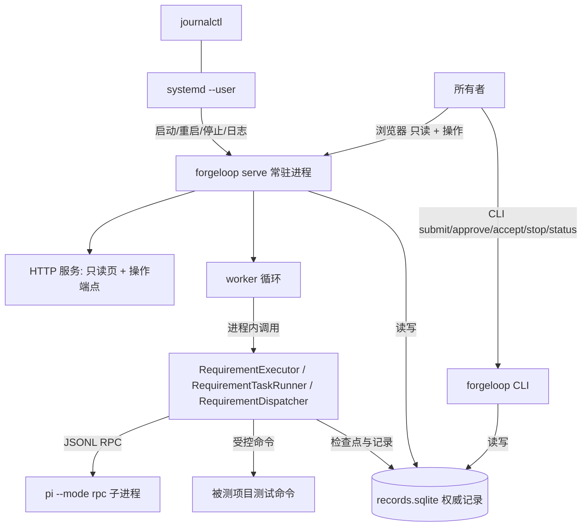

# ForgeLoop 常驻服务与页面操作入口方案（待评审）

| 项 | 内容 |
| --- | --- |
| 状态 | **方案（未实现、未批准）**：本文只写拟做范围、设计决定、文件范围与验收条件；批准后才进入实现 |
| 提出 | 2026-10-18，按所有者要求「产物应该是程序，可以后台常驻；有没有前台界面」 |
| 范围 | 新增常驻进程入口 `forgeloop serve`（systemd user unit 承载）、异步执行与唤醒、页面人工操作入口、重启恢复与副作用核对 |
| 不改动 | 现有 CLI 命令语义、业务图编排、批准绑定与失败累计规则、提交策略、发布/部署链路；本文档同批不产生任何代码改动 |
| 依赖文档 | [架构说明](architecture.md)、[待实现需求列表](pending-requirements.md)（B01/B02/B08/B09/B12）、[工程可靠性方案](engineering-reliability.md)（§22.2、§25）、[研发纪律](development-discipline.md)、[AGENTS.md](../AGENTS.md) |

---

> **实施状态（as-built）**：本方案四批 R1→R4 已实施并逐批验收；每批的实际改动、验证结果与**与本文的偏离**记录在 [status.md](status.md) 的对应条目（关键词：R1 常驻骨架／R2 常驻自动接续／R3 页面操作入口／R4 重启恢复／方案验收条件逐条审计）。已知偏离与落实（2026-10-18 所有者决定后更新）：① 提交的**幂等键**（§4.2）**已实现**——在既有 `requirements` 表加 `client_key` 列 + 部分唯一索引，同键同内容返回既有需求、同键不同内容 fail-closed 报 409，不新建业务状态表；② 写端点的 `reason` 只有批准/验收/停止必填（这些决定会写进权威记录），提交/推进可选；③ 启动核对新增问题种类 `outstanding_action`，而不是复用 §5 设想的 `interrupted`（实测：崩在 dev 中途时任务状态仍是「进行中」，状态分类覆盖不到）。另按所有者决定补齐**审计归属列**：`approvals`／`stops`／`requirements` 在既有表上加列，需求级验收同时落 `accepted_at`／`accepted_by`／`acceptance_source`／`acceptance_fingerprint`（验收绑定材料身份）。本文其余内容保持提交批准时的原样。

## 1. 所有者诉求与现状核对

### 1.1 诉求

- ForgeLoop 的产物应当是一个**程序**，能够**后台常驻**运行，而不是每次都由人敲一条命令、守着终端。
- 需要**前台界面**：目前只有一个页面，所有者要求明确其边界，并据此决定是否扩展到可操作。

### 1.2 现状（2026-10-18 实测，逐条给证据）

| 能力 | 现状 | 证据 |
| --- | --- | --- |
| 常驻进程 | **没有** | 仓库无 `*.service`／`*.plist`／daemon 代码；`forgeloop web` 是前台阻塞进程（`serve_forever()`，打印「按 Ctrl+C 停止」，[web.py:364](../src/forgeloop/cli/web.py)） |
| 长流程执行位置 | 在**调用它的 CLI 进程内**同步执行 | `requirement advance` 进程内调用 `executor.advance()`（[requirements.py:416](../src/forgeloop/cli/requirements.py)）；`dispatch` 同 |
| 调度平台 | 明确**未建设** | [dispatch.py](../src/forgeloop/graph/dispatch.py) 模块说明：「没有队列持久化，没有优先级、抢占或跨项目编排」「进程被强杀会留下未完成的执行槽位……后续推进拒绝重放」 |
| 周期触发 | 只有 cron 单次入口（邮件） | `forgeloop mail poll --once`（`--once` 必填，[mail.py:528](../src/forgeloop/cli/mail.py)）+ `mail confirm` 人工确认 |
| 图形界面 | **有，只读** | `GET /`（随包静态页）、`GET /api/progress`（由真实 SQLite 记录生成）；其余方法 405、未知路径 404；本次以真实 Chromium 打开真实服务截图核对（`.cache/web-demo/status-page.png`） |
| 页面操作入口 | **没有** | 没有写端点；页面无表单；所有批准/推进/验收只能走 CLI |
| 后台场景验收 | **未执行** | [AGENTS.md:40](../AGENTS.md) 要求后台场景另验「客户端断开后推进、决定后唤醒、重启恢复、副作用核对」；四项均无实现与记录 |
| PI 运行环境 | 直接宿主运行，`HOME` 由调用者决定 | [engineering-reliability.md §22.2](engineering-reliability.md)：凡会继续执行图并启动 PI 的命令必须在隔离 HOME 下运行（否则 `~/.pi` 写锁 EPERM）；容器隔离未接入（[status.md](status.md) 第 6 节） |

### 1.3 差距

把现状与诉求对齐，缺的是四件事，而不是"加一个页面"：

1. **一个常驻载体**：进程活着、接受请求、被 systemd 管理、日志可查。
2. **执行与请求解耦**：提交/批准后请求立即返回，执行在常驻进程内继续，客户端断开不影响。
3. **唤醒与恢复**：人工决定后自动接续；进程被杀后能核对现场，而不是盲目重放。
4. **页面上的写入口**：且必须复用 CLI 的同一套批准绑定、幂等与互斥，不能另写一套业务状态。

---

## 2. 目标与非目标

### 2.1 目标（R1–R4 全部验收后达到）

- 一条命令或一个 systemd unit 让 ForgeLoop 常驻：开机自启、崩溃重启、日志进 journal。
- 所有者在页面上提交需求、批准任务包、整体验收、请求停止；所有操作与 CLI 等价（同一领域入口、同一记录、同一判定）。
- 批准之后不需要人再敲 `advance`：常驻 worker 在可配置的开关下自动接续执行；人工决定后立即唤醒。
- 客户端断开、进程被 kill 都不产生"看起来成功"的假象：未完成动作与槽位进入人工核对清单，恢复路径始终可达。
- 页面与 CLI 共用**同一份**权威记录与读模型，不新增第二套业务状态。

### 2.2 明确不做（本方案范围外）

| 不做 | 原因 |
| --- | --- |
| 多用户、公网访问、登录鉴权 | B01 触发条件是「多人设备访问成为实际障碍」；本方案默认只绑定回环，非回环直接拒绝启动 |
| 跨项目优先级队列、抢占、公平调度 | 属 B09，依赖 B08 安全点能力；本方案最多做到「同项目串行、独立项目并行」的既有语义 |
| 需求级安全点暂停/恢复/取消 | 属 B08；本方案只做「重启后核对 + 人工恢复」，不新建暂停语义 |
| ForgeLoop 自升级 | 属 B07，依赖 B05/B06/B13 |
| 容器隔离、受限执行环境 | 属 V-A02/B01 单独验收；本方案沿用宿主运行，并如实标注风险 |
| 页面替代 CLI 的完整功能面 | 页面只做四类人工决定，不搬运全部 CLI 子命令 |
| 新建队列表或第二份业务状态 | 违反 AGENTS.md「新增入口复用既有工作项、批准、执行与交付规则」 |

---

## 3. 进程模型与设计决定

### 3.1 进程模型



### 3.2 组件职责

| 组件 | 位置（拟） | 职责 | 不负责 |
| --- | --- | --- | --- |
| `forgeloop serve` | `src/forgeloop/cli/serve.py`（`cli` 层） | 命令注册、进程生命周期（启动校验、信号处理、优雅停止）、HTTP 服务装配、把读模型与操作入口接起来 | 不实现业务规则、不直接跑图 |
| worker 循环 | `src/forgeloop/graph/worker.py`（`graph` 层） | 从权威记录推导「可推进」集合、占位互斥、调用既有执行器、进度与错误上报、启动核对 | 不重写编排、不做业务判定（判定在 `domain`） |
| 服务配置规则 | `src/forgeloop/domain/service.py`（`domain` 层） | 纯规则：端口/间隔/并发上限/`auto_advance`/PI HOME 校验，非法值显式失败 | 不读环境、不启动进程 |
| 页面行为 | `frontend/src/actions.ts` 等，编译到 `src/forgeloop/cli/static/` | 表单、令牌、结果与错误渲染 | 不做授权判定（服务端判定） |
| 常驻载体 | `runtime/systemd/forgeloop-serve.service`（模板） | systemd user unit：环境、重启策略、日志 | 不含业务配置 |

### 3.3 设计决定与取舍

**D1｜新增 `forgeloop serve`，不把 `forgeloop web` 改成常驻。**
理由：`web` 的已验证语义是「前台、只读、Ctrl+C 停止」，把它改成常驻会同时改变其生命周期与只读契约，并使一个已验收入口承担执行编排。`serve` 复用 `cli.web` 的读模型与页面模块（经 `ProgressDocuments` 注入），但拥有独立生命周期。
被否备选：① 只用 systemd 跑现有 `web` —— 只解决"页面常在"，不解决异步执行与唤醒；② 用 cron 周期调 `advance` —— 进程活不过一次执行，谈不上唤醒与并发占用。
代价：两个入口并存，文档需要说清分工（`web` = 开发期前台查看；`serve` = 常驻）。

> **2026-10-22 所有者决定（D1 的后续调整）**：Web 定位改为**操作管理界面**，`forgeloop web` 不再是只读状态页，而是前台 Web 操作台（会话 + 需求 CRUD + 分析/规划/人工决定），`serve` 是同一套页面与写入口的常驻版本。D1 中「`web` 只读」的契约已被本决定取代；「不把 `web` 改成常驻」仍然成立——`web` 保持前台、Ctrl+C 停止，常驻与自动接续仍归 `serve`。实现见 `cli.console`、`cli.serve` 与 [status.md](status.md) 2026-10-22 条目。

**D2｜worker 在常驻进程内**复用既有业务图入口**，不通过子进程再调 CLI。**
理由：进程内调用可直接复用批准绑定、失败累计、工时限额、槽位互斥与检查点写回；子进程方案要重新拼参数、解析 stdout、复制错误处理，等于第二套入口。
被否备选：systemd 定时拉起 `requirement advance`（无法表达"正在运行"、无法唤醒、每次冷启动）。
代价：常驻进程与 PI 子进程同一崩溃域；用 systemd `Restart=on-failure` 与 §5 的核对流程兜底。

**D3｜唤醒 = SQLite 轮询兜底 + 同进程事件加速。**
worker 按 `poll_seconds`（默认 2 秒）扫描权威记录；HTTP 操作与同进程状态变化额外 `Event.set()` 立即唤醒。跨进程（另开终端跑 CLI）只能靠轮询，延迟上界即 `poll_seconds`。
被否备选：引入消息队列/Redis（新基础设施，与「简单优先」冲突）；文件监听（SQLite WAL 变更不可靠）。
代价：空转轮询带来轻微 DB 负载；延迟可配置。

**D4｜执行参数来自 `config/service.toml` 的项目档案，不由调用方每次传入。**
现在 `requirement advance --pi-command --project-path --baseline` 是每次传入的；常驻进程没有调用方，必须有可校验的配置来源。配置非法时**启动即失败**（与 `config/web.toml` 的 `refresh_seconds` 同口径，不静默回落）。
被否备选：把执行参数记进需求提交表单 —— 会把执行配置混进业务记录，且页面表单膨胀。
代价：多一份需要维护与校验的配置文件。

**D5｜页面操作复用领域入口，并加同源 + 令牌 + 审计三重约束。**
页面写操作调用与 CLI **同一个**函数（`requirement submit/approve/accept`、停止记录），因此批准仍绑定 `req_id` + 任务包版本、重复批准幂等、越权与过期一律拒绝。HTTP 层额外要求：仅接受 POST、校验同源（`Origin`/`Referer`）、校验页面注入的一次性令牌（`GET /` 时生成，随页面 meta 下发，请求头回传）、**非回环地址拒绝启动**；`by`／`reason` 必填并落既有批准/动作记录。
被否备选：页面自己写记录（第二套状态，明确禁止）；无令牌只靠同源（本机其他进程可伪造同源请求）。
代价：前端要管理令牌与错误展示；浏览器多标签刷新后令牌需重新获取。

**D6｜重启不自动重放，进入人工核对。**
启动时扫描未完成动作（`actions` 表的 `started`）与未完成执行槽位，生成「需人工核对」清单并通过 `GET /api/service` 与页面「问题」段暴露；恢复仍走既有 `requirement slot list|clear`、`requirement actions list|clear`、`requirement retry`。
理由：AGENTS.md 明确「中断核对与禁止盲目重放」；[dispatch.py](../src/forgeloop/graph/dispatch.py) 已把该语义写进模块契约。
代价：崩溃后需要一次人工核对，不能无人值守恢复（这是有意选择，不是缺口）。

**D7｜日志进 journal，进程内不建日志平台。**
stdout/stderr 由 systemd 收进 journal（`journalctl --user -u forgeloop-serve`）；`GET /api/service` 暴露最小运行状态（启动时间、worker 是否在跑、正在运行的需求集合、上次错误摘要、生效配置路径与轮询间隔）。

**D8｜PI 的 `HOME` 显式配置，不继承调用者环境。**
按 [engineering-reliability.md §22.2](engineering-reliability.md)：隔离目录需含可用的 `~/.pi`（`models.json` 存在且非空），否则 PI 报 `Unknown provider` 或写锁 EPERM。unit 与 `config/service.toml` 显式给出 PI HOME；缺失或判据不满足时**拒绝启动**并说明原因，不在宿主 HOME 下静默派生 PI。

---

## 4. 接口设计

### 4.1 CLI 新增

```
forgeloop serve [--records-root .forgeloop] [--host 127.0.0.1] [--port 8712]
                [--service-config config/service.toml] [--once]
```

- 默认端口 8712（`web` 用 8710，前端 e2e 用 8711，避免互相占用）。
- `--host` 非回环 → 启动失败并提示（本方案不支持远端访问）。
- `--once`：只做一次启动核对并打印状态后退出，供 CI 与系统测试使用，**不常驻**。

### 4.2 HTTP 端点（拟）

| 方法 | 路径 | 用途 | 成功 | 主要失败码 | 幂等 |
| --- | --- | --- | --- | --- | --- |
| GET | `/` | 页面（含一次性令牌 meta） | 200 html | — | 幂等 |
| GET | `/api/progress` | 现有读模型，不变 | 200 json | — | 幂等 |
| GET | `/api/service` | 常驻状态与人工核对清单 | 200 json | — | 幂等 |
| POST | `/api/requirements` | 提交需求 | 201 `{req_id}` | 400 参数、403 令牌、409 重复幂等键 | 幂等键（客户端 UUID） |
| POST | `/api/requirements/{req_id}/approve` | 批准任务包（绑定身份+版本） | 200 决定 | 403、404、409 版本过期 | 重复批准返回既有决定，不重复消耗 |
| POST | `/api/requirements/{req_id}/advance` | 请求推进本次 | 202 | 403、404、409 已在运行 | 同需求并发只允许一个 |
| POST | `/api/requirements/{req_id}/accept` | 整体验收 | 200 | 403、409 未全部交付 | 同上 |
| POST | `/api/requirements/{req_id}/stop` | 请求停止 | 202 | 403、404 | 重复请求为同一事实 |
| — | 其他方法/路径 | 405 / 404（沿用现有口径） | — | — | — |

约束：所有写端点都要求 `by`、`reason`；服务端记录操作来源为 `web`；审计落既有 `approvals`／`actions`／停止记录，不新建审计表。

### 4.3 `config/service.toml`（拟）

| 键 | 默认 | 校验 |
| --- | --- | --- |
| `schema_version` | 1 | 必须匹配 |
| `host` / `port` | `127.0.0.1` / 8712 | 非回环拒绝；端口范围校验 |
| `poll_seconds` | 2 | 正整数；0 非法 |
| `max_concurrent` | 2 | ≥1 整数 |
| `auto_advance` | `false` | 布尔；**默认关闭**，开启后「批准即可自动接续执行」 |
| `[projects.<name>]` | — | `path`、`pi_command`（JSON 数组）、`test_command`、`baseline`、`pi_home`；被引用项目缺失即启动失败 |

配置由 `domain/service.py` 纯规则校验，配置损坏、项目档案缺失、PI HOME 判据不满足 → 启动失败并打印原因（失败关闭）。

---

## 5. 状态、恢复与副作用核对

- **不新建业务状态**：需求、任务、批准、失败轮次、槽位、动作全部沿用现有 SQLite 表（[architecture.md §6](architecture.md)）。
- **可推进集合**由记录推导：需求已批准任务包 + 有未完成任务 + 无未完成槽位 + 未被请求停止 + 工时未耗尽；worker 不自建队列，重启后推导结果自然恢复。
- **启动核对**：列出未完成动作与残留槽位 → 标记需人工核对 → 在页面上以「问题」段呈现（复用 `domain.progress` 的 `slot_residue`／`interrupted` 分类）。
- **恢复路径**：核对现场 → `requirement actions clear` / `requirement slot clear` → `requirement retry --by --reason` 续跑；worker 不自动执行这条路径。
- **副作用核对**：恢复后核对工作副本与候选 diff 的身份（沿用现有交付材料绑定），确认"上次动作到底做了什么"再决定是否重跑。

---

## 6. 硬规则与强制机制（按 AGENTS.md：必须有确定性代码强制）

| 规则 | 判定来源 | 强制位置 | 违规行为 |
| --- | --- | --- | --- |
| 只允许回环访问 | `domain.service` 配置校验 | `serve` 启动入口 | 拒绝启动 |
| 写操作需同源 + 令牌 | 服务端会话令牌 | HTTP 写端点 | 403，不落记录 |
| 批准绑定需求身份与任务包版本 | `domain.approval`（既有） | 与 CLI 同一函数 | 拒绝并报告原因 |
| 重复批准/验收幂等 | 既有 `approval_consumption` | 同一函数 | 返回既有决定，不重复消耗 |
| 同需求并发只允许一个执行 | 记录层执行槽位（既有） | `RequirementExecutor`／`actions.claim_slot` | `RequirementAlreadyRunningError` |
| 同项目交付串行 | 项目交付槽位（既有） | `dispatch.project_delivery` | 超时拒绝，不并发更新主干 |
| 未核对的动作/槽位不得推进 | `actions` 未完成事实 | worker 前置检查 | fail-closed 拒绝推进 |
| 失败累计与工时限额 | `domain.limits`（既有） | 动作节点启动前 | 超限停止并报告 |
| 停止请求生效 | 既有停止记录 | 动作节点启动前 | 不再启动新动作 |
| 非回环/无令牌/越权 | 见上 | 服务端 | 一律失败关闭，不回落到"当作没请求" |

---

## 7. 文件范围（分批，逐条列出；范围外的问题记入「发现但不碰」）

### R1 常驻骨架（不含任务执行）

新增：`src/forgeloop/domain/service.py`、`src/forgeloop/cli/serve.py`、`src/forgeloop/graph/worker.py`（骨架：只做启动核对与状态上报）、`config/service.toml`、`runtime/systemd/forgeloop-serve.service`、`tests/unit/test_service_config.py`、`tests/integration/test_serve_server.py`、`tests/system/test_serve_process.py`
修改：`src/forgeloop/cli/main.py`（注册 `serve`、注入读模型）、`scripts/export_cli_contract.py`、`contracts/cli-contract.json`、`contracts/architecture.json`、`docs/architecture.md`（§1／§3／§6／§7）、`docs/deployment.md`（常驻安装一节）、`docs/status.md`、`README.md`

### R2 异步执行与唤醒

新增：`tests/unit/test_worker_scheduling.py`、`tests/property/test_worker_idempotent.py`、`tests/integration/test_worker_execution.py`、`tests/system/test_serve_async.py`
修改：`src/forgeloop/graph/worker.py`、`src/forgeloop/cli/serve.py`、`config/service.toml`（`auto_advance`）、`docs/architecture.md`（§4 业务图补常驻推进入口）、`contracts/architecture.json`、`docs/status.md`

### R3 页面操作入口

新增：`frontend/src/actions.ts`、`frontend/tests/unit/actions.test.ts`、`frontend/tests/component/actions.test.ts`、`frontend/tests/e2e/operations.spec.ts`、`src/forgeloop/cli/static/actions.js`（编译产物）、`tests/integration/test_serve_operations.py`、`tests/system/test_serve_operations_process.py`
修改：`src/forgeloop/cli/serve.py`、`src/forgeloop/cli/web_page.html`、`frontend/src/app.ts`、`frontend/src/payload.ts`、`frontend/src/render.ts`、`frontend/.dependency-cruiser.cjs`、`scripts/export_cli_contract.py`、`contracts/cli-contract.json`、`docs/architecture.md`（§7 前端接缝）、`docs/status.md`、`README.md`

### R4 重启恢复与副作用核对

新增：`tests/scenario/test_service_restart.py`、`tests/system/test_serve_kill_recovery.py`
修改：`src/forgeloop/graph/worker.py`、`src/forgeloop/cli/serve.py`、`docs/status.md`、`docs/deployment.md`

每批都必须同步：架构变化 → `docs/architecture.md` + `contracts/architecture.json` + `make architecture-contract`；对外输出变化 → `contracts/cli-contract.json` + `make cli-contract-check`；前端改动 → `make frontend-build` 写回随包产物 + `make frontend-check`。

---

## 8. 里程碑与验收条件

每批独立验收；**不通过则不进下一批**。假 PI 的通过只证明编排，不算真实模型闭环。

### R1 常驻骨架

- 范围：`serve` 起得来、停得干净、页面可访问、状态可查；不执行任何任务。
- 验收：真实子进程启动 + 真实回环 HTTP（`GET /`、`/api/progress`、`/api/service`）；`SIGTERM` 后退出码 0 且端口释放；非法配置（非回环 host、坏端口、缺项目档案、PI HOME 判据不满足）启动即失败并给出原因；`--once` 退出码 0。
- 手工验收（本机 Debian）：`systemctl --user enable --now forgeloop-serve`，`systemctl --user restart` 后服务恢复，`journalctl --user -u forgeloop-serve` 可见启动与停止日志。

### R2 异步执行与唤醒（后台四项之前两项）

- 范围：提交/批准后请求立即返回，worker 执行；`auto_advance` 开关生效。
- 验收（真实子进程 + 真实 SQLite + 假 PI）：
  - **客户端断开后推进**：发起推进请求后立即断开连接，断言任务继续到 `awaiting_acceptance`（记录状态 + 动作历史）。
  - **决定后唤醒**：worker 空闲时由另一个进程写入批准，断言 `poll_seconds` 内出现新的 `started` 动作并在无人工干预下推进。
  - 停止生效：请求停止后不再启动新动作（断言动作历史无新增 `started`）。
  - 并发互斥：同需求并发推进只有一个成功；不同项目可并行、同项目交付串行。

### R3 页面操作入口

- 范围：页面上提交、批准、推进、验收、停止；令牌与同源校验；审计字段完整。
- 验收：真实浏览器（Playwright + 真实 `serve` 进程 + 真实记录）完成一次「页面提交 → 页面批准 → 自动推进 → 页面验收」；缺令牌/跨源/非 POST 一律 403/405 且**不产生记录**；重复批准不重复消耗；过期版本批准被拒且页面显示原因；页面不出现注入执行（沿用现有纯文本渲染断言）。

### R4 重启恢复与副作用核对（后台四项之后两项）

- 范围：启动核对、人工核对清单、禁止盲目重放。
- 验收：
  - **重启恢复**：执行中 `kill -9` 服务 → 重启 → 断言**没有**自动重放，未完成动作与残留槽位出现在 `GET /api/service` 与页面「问题」段；`requirement actions list` 可见；核对清理后可重新推进成功。
  - **副作用核对**：对照工作副本与候选 diff，确认上次动作结果与记录一致后才允许续跑（不一致时保持人工核对状态）。
  - 断电式重启（`systemctl --user restart` 与 `kill -9` 两种）均验证。

---

## 9. 测试计划

| 层 | 内容 |
| --- | --- |
| unit | `domain.service` 配置规则（含负例）、幂等键规则、可推进集合推导 |
| property | 幂等与互斥不变量（重复操作不产生第二条事实；同需求并发最多一个执行） |
| component | HTTP 端点契约：状态码、错误码、响应形状、405/404 口径 |
| integration | 真实回环端口 + 真实 SQLite + 假 PI：读写端点、令牌与同源拒绝、断开后继续 |
| system | 真实 `serve` 子进程：SIGTERM 优雅、SIGKILL 恢复、`--once`、配置失败、后台四项 |
| scenario | 服务生命周期与业务图联合（提交→批准→推进→验收→停止→重启核对） |
| 前端 | Vitest（jsdom，覆盖门槛 90%）+ Playwright（真实 Chromium 操作流）+ Stryker（夜间，沿用现阈值）+ depcruise/knip 边界 |
| 手工（不进 CI） | systemd user unit、开机自启、journal 日志、真实断电式重启 |

反例必须存在：无令牌、跨源、非回环绑定、版本过期批准、重复批准、崩溃后重放尝试、停止后新动作——每条都要有"被拒绝且不产生记录"的断言。

---

## 10. 风险、代价与未落实项（如实记录）

- **systemd 与 journal 无法在 CI 强制**：容器/CI 内不可验，只能手工验收；本项在 CI 门禁中**未落实**，会如实标注。
- **常驻扩大崩溃与权限面**：PI 仍直接宿主运行（容器隔离未接入）；常驻进程被杀会留下未完成动作，必须人工核对。
- **`auto_advance` 改变节奏**：开启后"批准即执行"，与现在"批准后人工 advance"不同；默认关闭，开启需所有者明确同意。
- **页面无鉴权**：即使只回环，本机其他进程理论上可发请求（令牌 + 同源降低风险，不等于鉴权）；多人/公网访问仍是 B01 未实现部分。
- **轮询延迟**：跨进程唤醒延迟上界为 `poll_seconds`；实时性要求提高时需要另做机制（本方案不做）。
- **结构数字**：`serve.py` 与 `worker.py` 需按结构报告审阅阈值控制体量；按纪律**不为数字拆改**，需要拆分时另提方案。
- **真实模型闭环未验**：R1–R4 的自动验收以假 PI 为主；真实模型下的常驻长跑需单独验收并记录。

---

## 11. 发现但不碰（本次核对发现，不在本方案范围）

1. [status.md:133](status.md) 与 [status.md:214](status.md) 仍写「仓库无标签／S1 真实发布未执行」，与已存在的 `v0.0.1` 标签及 GitHub Release（2026-10-15 05:22 +0800，Release 作业 success）矛盾；[status.md:220](status.md) 写「`~/.local/bin/forgeloop` 当前不存在」，与本机实际存在的安装不一致。
2. [README.md:15](../README.md) 写「邮件入口仍未做」，但 `forgeloop mail poll|confirm`、`records/mail_threads.py` 与 CLI 契约中的 mail 节均已存在（提交 `dc300aa`、`eb6ee72`）。
3. 本次核对期间工作区有并发会话改动（HEAD 由 `b1ce064` 前进到 `f1c676e`，两份文档一度被回退又重新出现），本方案未触碰这些文件。

以上三条如需订正，建议单独立项，不并入本方案。

---

## 12. 待所有者决定

| # | 问题 | 建议 |
| --- | --- | --- |
| 1 | 常驻载体是否就用 systemd user unit（本机 Debian 已是部署目标）？ | 是；不引入容器/进程管理器 |
| 2 | `auto_advance` 默认值？ | 默认**关闭**，验收时显式开启；确认后再考虑默认开启 |
| 3 | 页面首批操作做几项？ | 提交、批准、推进、验收、停止五项；不做 grant/merge/release/deploy |
| 4 | 端口与访问范围？ | `127.0.0.1:8712`，非回环拒绝启动 |
| 5 | 常驻服务的安装与升级是否纳入现有发布/部署链路？ | 本方案先手工安装 unit；纳入 `release`/`deploy` 另提方案 |
| 6 | 是否先只做 R1+R2（常驻与自动接续），页面操作入口（R3）随后？ | 建议按 R1→R2→R3→R4 顺序，每批单独验收 |

批准方式：所有者明确回复要做哪几批（例如「批准 R1+R2」）后才进入实现；实现批次按本文件 §7 的文件范围执行，范围外问题记入「发现但不碰」。
